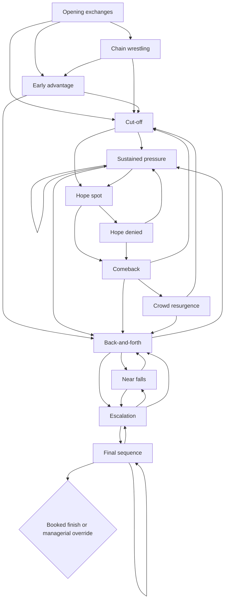
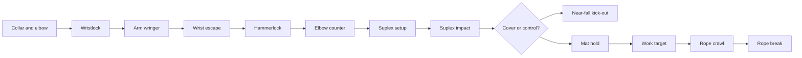

# The Office — causal match graph (v2.7)

This is a **wrestling-psychology simulation model**, not a recreation of actual matches, a licensed move library, or a machine-learning model trained on wrestling footage. The original node sequences are informed by documented match breakdowns and wrestler interviews, with the finish still governed by the player's contract and permitted mid-match choices.

## Architecture

The match engine is now a pair of related, explicitly inspectable directed weighted graphs, plus a guarded outcome graph. All state is stored as serialisable data in `M.graph` and `M.story`. Both survive a browser refresh.

### Story graph: 13 arcs



The edges have weights modified by the match style, crowd, feud heat, progress through the scheduled time and repetition. The match is *not* compelled to visit every arc. Even when the producer needs a finish, the engine takes the shortest coherent route to it.

### Action graph: 59 connected nodes, 172 edges

The action graph operates inside each story arc. Nodes have:

- **Preconditions:** standing, grounded, corner, floor or top rope; a cover needs a downed defender inside the ring.
- **Effects:** attacker in control, defender down, target-body-part damage, crowd reaction, knockdown, reversal or legal rope break.
- **Weighted outgoing edges:** a headlock leads into a rope-shove, takeover or headlock escape; an Irish whip sets up a rebound or counter; a floor brawl offers an apron exchange, counter or a return to the ring.
- **Memory:** action history, ring location, control, damage separately for each wrestler, near-fall count and planned finish.
- **Explicit recovery:** the engine must narrate a return to standing, to the ring, or to a legal pinning position rather than teleporting from one to another.

Action graph examples:



### Outcome graph

The outcome graph contains six guarded states:

| Node | Guard | Finish |
| --- | --- | --- |
| `win_clean` | Booked clean win | Counter/setup → finisher or submission → pin/tap |
| `win_dirty` | Booked dirty win | Distraction → illegal roll-up → referee counts |
| `lose_protected` | Booked protected loss | Near finish → rope escape → disputed pin |
| `lose_clean` | Booked decisive loss | Failed attack / counter → opponent's finisher |
| `nc` | Injured wrestler and explicit stoppage | Referee/doctor stops bout |
| `double` | Explicit go-into-business choice | Break booked finish, reverse, unplanned win |

These outcomes are recorded in the match report; no player win is secretly decided by graph randomness.

## Research grounding and patterns

* **Classic territory build:** opening / shine / heel cut-off / heat / false hope / comeback / finish. Based on professional wrestler Matt Murphy's match-structure discussion: https://missouriwrestlingrevival.com/2009/12/23/chapter-15-match-structure-by-matt-murphy/
* **Technical counter chain:** wristlocks, counters, mat work and an ending that pays off earlier holds. Guided by a detailed description of Hart vs Austin (Survivor Series 1996): https://tjrwrestling.net/feature/5-star-wwe-bret-hart-steve-austin-1996/
* **Grudge and ringside brawl:** multiple changes in control, floor fighting, visible limb damage and aggressive finishing action. Guided by a move-flow analysis of Hart vs Austin (WrestleMania 13): https://www.prowrestlingmusings.com/post/greatest-matches-of-all-time-bret-hart-vs-steve-austin
* **Reusable counters and callbacks:** FTR described studying Flair/Steamboat and Hart/Bulldog sequences to understand how early holds become later counter-spots: https://wrestlingheadlines.com/ftr-on-how-they-developed-their-in-ring-psychology/
* **Injury selling:** a body-part attack should reduce or complicate relevant later actions, rather than appear only as colourful narration: https://insidepulse.com/2005/03/23/35628/
* **Audience response:** wrestlers should be able to change an in-ring plan when a crowd does not respond, as explained by Shelton Benjamin: https://www.tpww.net/2018/08/interview-shelton-benjamin-on-calling-matches-in-the-ring-crowd-reactions-who-he-trusts-during-matches/

These are **design motifs**, not complete manually annotated move-by-move datasets. A future data-lab pass should annotate complete footage or legally available play-by-play at the event level, measure transitions by style/duration, and use those observations to recalibrate edge weights.

## Regressions

```sh
node tests/match-flow.test.cjs
node tests/graph-flow.test.cjs
```

The graph suite checks all node and arc reachability, action legality, reversal ownership, ring location and floor-fighting transitions, distinct storyline paths, booked outcomes, and old/new save compatibility. It is dependency-free and uses Node's built-in libraries.

## Compatibility

- Existing v2, v2.1, v2.2, v2.3 and v2.5/v2.6 career saves remain under the existing storage keys.
- In-progress v2.6 bouts lacking graph fields migrate at the current match clock and stage.
- The v2.5 interface, match-night chrome, colours and page layout are intentionally unchanged.
