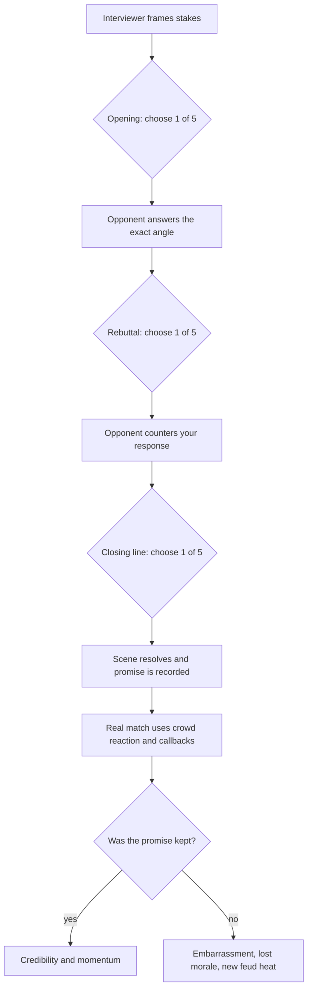

# The Office v2.8 — Promo dialogue graph

The promo system is a branching interactive **three-act encounter**, not a menu that shows four computed scores and lets the player choose the largest.

## Flow



The 15 choice nodes define **125 possible paths** (5 × 5 × 5), with further variation from personality, microphone ability, opponent replies, feud history, current stakes, crowd response and deterministic dialogue variants. Rivalries retain the previous promo angle and promise for future callbacks.

The three stages are: an opening (crowd appeal, competitive proof, elaborate metaphor, accusation or swagger); a rebuttal (turn their words around, get personal, callback, remain calm or challenge); and a close (promise victory, name the finishing move, demand a fair fight, leave the opponent guessing or ask a final question).

### Why the choices matter

- **Audience:** Helps create a crowd atmosphere at the next match.
- **Heat:** Helps build rivalries and raise the stakes for a potential blow-off.
- **Credibility:** Can increase stable reputation, but may lose traction with poor delivery.
- **Professional relationships:** Cutting personal remarks can cost promoter trust; composed responses can build it.
- **Wrestler morale:** A strong performance can lift confidence, while an embarrassing line or broken promise damages it.
- **Promise:** A public statement is *not* an immediate bonus. Its consequences are resolved against the actual match. A win promise must be followed by a victory, a named-finisher promise by a clean finishing move, and a fair-fight promise by a clean result.

No numerical rating, projected crowd increase or predicted rivalry gain appears in the decision screen. After each selection, that line is *committed*, the opponent responds, and the next decision opens. The screen displays only the present exchange, keeping the existing 1990s office-manager UI and single-screen presentation intact.

The game preserves full dialogue in match history. The active conversation, including selection and random state, is saved in the existing match-night local storage key and resumes after a refresh. Old single-shot promos load unchanged.

## Research and transcript references

Research establishes *structure*, not text to copy. All dialogue in the game is newly written.

**Randy Savage, 1985–89**

1. [WWF, “Cream of the Crop” (May 11, 1987)](https://www.wwe.com/videos/macho-man-randy-savage-claims-he-s-the-cream-of-the-crop-prime-time-wrestling-may-11-1987) — a small visual prop becomes a refrain and an enormous personal claim. We adapt the **image → repetition → payoff** method using an arena clock, bell, ring lights, curtain or microphone, never his actual script.
2. [CAGEMATCH, “Hulkamania is dead” (March 27, 1989)](https://www.cagematch.net/?id=93&nr=1716) — self-justification, accusation, repetition and an absolute closing declaration. We adapt **accusation → opponent response → escalation or restraint**.
3. [CAGEMATCH, WWF interview (October 17, 1987)](https://www.cagematch.net/index.php?id=93&nr=1423) — distinctive absurd imagery tied to a specific opponent and future event. We adapt the idea of a memorable metaphor which can also fail if the speaker overreaches.
4. [WWE, the Mega Powers breakup (February 3, 1989)](https://www.wwe.com/inside/listthis/hardesthitting/betrayals3) — gestures, mistrust and previous events make the words more meaningful; an accusation can turn the subsequent match into a personal feud.

**Match payoffs**

5. [Savage vs Ricky Steamboat, WrestleMania III — match analysis](https://wrestletalk.com/features/behind-the-match-ricky-steamboat-vs-randy-savage-wrestlemania-iii/) — a previously injured throat, contested control, reversals, a ringside distraction and a protected win all pay off existing stakes. Our promo promises are likewise tracked into the result.
6. [Savage vs Ultimate Warrior, WrestleMania VII — WWE retrospective](https://www.wwe.com/inside/listthis/maniamatches/maniamatches3) — emotional stakes, a shocking survival of repeated finishing attacks and a post-match storyline change. This suggests future extensions: **higher-stakes promises and post-match confrontation branches**.

The source accounts are qualitative examples. We have **not** estimated real-world transition probabilities from a systematic dataset of promo transcripts, and the game does not reproduce copyrighted dialogue.

## Testing

```shell
node tests/promo-flow.test.cjs
node tests/match-flow.test.cjs
node tests/graph-flow.test.cjs
```

The promo suite covers 625 generated scenes, all 125 paths, adversary responses, distinct result tradeoffs, exact mid-scene resume, promises kept and broken, match integration and duplicate-payment guards.

## Compatibility

- This is an additive engine upgrade. The established theme, sidebar, office layout and ring-display styling are unchanged.
- Existing saved careers and mid-match saves continue under the existing storage keys.
- Old saved v2.5 single-shot promo scenes display their original words and can proceed to the bell.
- Existing bout flow and contracted finishes remain under the match graph.
