

  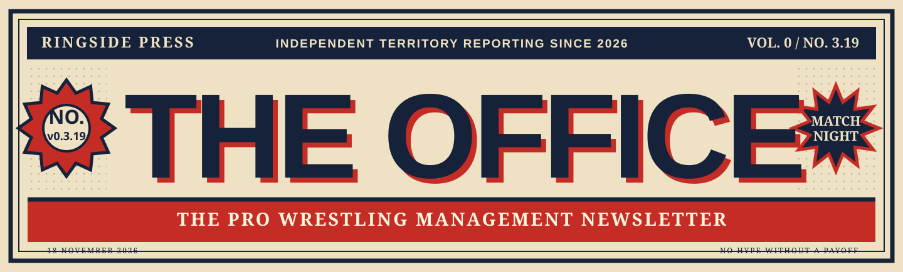

<strong>ISSUE v0.65</strong> &nbsp; • &nbsp; 23 NOVEMBER 2026 &nbsp; • &nbsp; THE TERRITORY TALKS BACK

<strong>THE MATCHES ARE SCRIPTED. THE PEOPLE AREN'T.</strong>

  <strong><a href="https://theoffice.repos.one/">PLAY THE OFFICE</a></strong>
  &nbsp; · &nbsp; <a href="docs/README.md">Inside the engine &amp; contributor guide</a>
  &nbsp; · &nbsp; <a href="#back-issues">Back issues</a>

  <a href="#how-to-play">How to play</a> &nbsp; · &nbsp;
  <a href="#how-the-game-works">The main systems</a> &nbsp; · &nbsp;
  <a href="#the-living-roster">The roster</a> &nbsp; · &nbsp;
  <a href="#the-main-event">The Main Event — what's new</a>

## HOW TO PLAY

*From the road agent: nobody gets a payday by staring at the fixture list.*

**The Office** is a free, browser-based **British wrestling management game**. You run a small stable on a fictional independent circuit: sign talent, deal with bookers, prepare matches, handle the microphone and live with the consequences. The promoters choose the booked results. Your decisions determine how the work goes — and whether anyone wants to book you again.

**Your first week, in five moves:**

1. **Sign a wrestler.** Start a **New career** and open **Roster → Free agents**. You've got **£2,250** and room for **five contracts**. Look beyond ring skill: wages, personality, microphone work and condition all matter.
2. **Find a booking.** Open **Bookings → Offers**. Check the opponent, money, billing and proposed finish. Negotiate if you've got a case; pushing too hard can cost you.
3. **Run the office.** Read the inbox, choose a training focus, check fatigue and use your management meetings wisely. The other managers aren't sitting idle.
4. **Work the show.** Press **Continue** when you're ready. Dennis, your road agent, helps you agree a match layout and any backstage decisions. Cut a promo, then follow the bout in live text commentary. You can call instructions from ringside.
5. **Collect the consequences.** Read the report, decide what happens after the bell and check the next offers. A good match can build a rivalry; a broken promise can come back weeks later.

The career is **16 weeks per season** and autosaves in your browser. **Game → Export save** makes a portable copy; **Import save** restores one. Play on desktop or mobile. There's no account to create or software to install.

## HOW THE GAME WORKS

*The main engines and systems. The workings of the territory, not a list of every button.*

### FOUR BOOKERS, ONE TERRITORY

**Dockside**, **Pulse Underground**, **North Crown** and **Grand Union** are rival promotions with their own crowds, budgets and ideas about wrestling. Their bookers control the cards, the winners, the title picture and the long-term programmes. The eight championships belong to the promotions, not to you. **Territory → Booking sheets** shows which feuds, title chases and pushes are gathering momentum.

You manage the wrestlers, not the entire promotion. The six rival managers compete for contracts and card positions, lobby the bookers and can poach an unhappy talent. Promoters remember reliability, money arguments and the matches you actually deliver. Empty weeks and bad deals cost cash.

### PEOPLE BEFORE NUMBERS

Every one of the **80 fictional wrestlers** has their own attributes, moves, relationships, ambitions and way of speaking. Wrestling style, technical background and weekly training are different things: a fearless flyer can still be poor on the microphone; a safe pair of hands may have no taste for a big spot.

Wrestlers develop, get tired, carry injuries and remember slights. You can train them, rehearse with Dennis and read his assessment of likely gains and risks. As seasons pass, youngsters mature, veterans lose a step and some leave the business. A wrestler is a person on your payroll, not a stat you can endlessly grind.

### THE AGENTS' ROOM AND THE MIC

Before the bell, Dennis and both wrestlers work out the **signed match plan**. Choose the performance approach — **Story, Technical, Brawl, Spot-fest or Safe** — and, if it suits the booking, an additional dramatic structure such as **Classic American, King's Road, Chickenshit Heel or Dominant Ace**. Agree real moves and objectives, handle objections and accept that the wrestlers may change course when they get out there. The **booked winner and finish remain the booker's call**.

Promos are conversations, not a single charisma roll. Open an argument, hear the reply, choose whether to push it and make promises the actual match might have to honour. Wrestlers remember who insulted them, who conceded a point and who talked a big game before losing.

### THE WRESTLING BETWEEN THE BELLS

The live match uses a **graph-based wrestling engine**, with authored moves, legal transitions, ring position, fatigue, counters and real physical consequences. The clock and the plan shape the contest, but they can't conjure a legal move from nowhere. A two-count needs a credible knockdown. A comeback needs a real change of control. A tired wrestler may simply have nothing left for the spectacular finish you wanted.

The text commentary reports the action as it unfolds. You can call for more pace, a breather, a crowd reaction, a big moment or the finish — but the wrestler has to listen, and the opportunity has to exist. Afterwards, the report compares the sheet you signed with what **actually happened**.

### A CIRCUIT THAT REMEMBERS

Results, promos, backstage rows, debts of trust and rivalries feed into later weeks. One match can start a programme; five meetings between the same pair needn't tell the same story. The match engine, career bookers and character memories use deterministic simulation so saves can be resumed and investigated, rather than invented history being filled in behind your back.

[**Engine architecture**](docs/architecture.md) · [**Graph Lab**](https://theoffice.repos.one/tools/graph-lab/) · [**Match-structure development**](https://github.com/southernadd-cmyk/wrestler/pull/194)

## THE LIVING ROSTER

*From the picture desk: eighty characters, no two careers quite the same.*

The 80-wrestler circuit includes technical specialists, brawlers, flyers, veterans and hopefuls. Your stable can hold **five** of them, while the rest compete for rival managers and promoters. Their starting strengths are only the beginning: contracts, injuries, training and the people they work with change what happens next.

<strong>Open the full 80-wrestler portrait gallery</strong>

<!-- LIVING ROSTER START -->
<table align="center">
<tr>
<td align="center">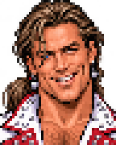 Ace Cassidy</td>
<td align="center"> Aisha Moreno</td>
<td align="center"> Alina Fox</td>
<td align="center"> Anya Ortez</td>
<td align="center"> Ari Keats</td>
<td align="center"> Ash Carter</td>
<td align="center"> Ayla Bay</td>
<td align="center">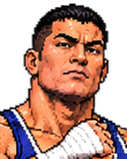 Bao Merrick</td>
</tr>
<tr>
<td align="center"> Bashir Lowe</td>
<td align="center">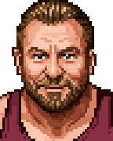 Brick Mercer</td>
<td align="center">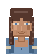 Brontë Hayes</td>
<td align="center">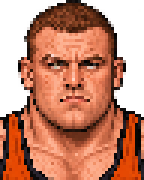 Cal Rourke</td>
<td align="center"> Cass Rae</td>
<td align="center"> Cedric Bloom</td>
<td align="center"> Cleo Watt</td>
<td align="center"> Dax Hollis</td>
</tr>
<tr>
<td align="center"> Dean Blackwell</td>
<td align="center"> Dee Okafor</td>
<td align="center"> Dev Hart</td>
<td align="center"> Eira Solis</td>
<td align="center"> Ellis Quade</td>
<td align="center"> Elodie Quinn</td>
<td align="center"> Emmett Briggs</td>
<td align="center"> Ezra Quill</td>
</tr>
<tr>
<td align="center"> Faye Calder</td>
<td align="center"> Felix Orr</td>
<td align="center"> Gideon Frost</td>
<td align="center"> Gus Marr</td>
<td align="center">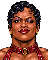 Imani King</td>
<td align="center"> Iris Vaughan</td>
<td align="center"> Ivo Serrano</td>
<td align="center"> Jett Harlow</td>
</tr>
<tr>
<td align="center"> Jun Park</td>
<td align="center">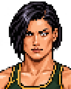 Juno Stark</td>
<td align="center"> Kellan Ryu</td>
<td align="center"> Kezia North</td>
<td align="center"> Kira Sato</td>
<td align="center"> Kit Marlowe</td>
<td align="center"> Kofi Hale</td>
<td align="center"> Leandro Moya</td>
</tr>
<tr>
<td align="center">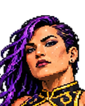 Liya Fen</td>
<td align="center"> Lyra Knox</td>
<td align="center">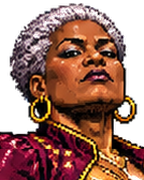 Mae Okoro</td>
<td align="center"> Magnus Graves</td>
<td align="center"> Malik Knight</td>
<td align="center"> Mara Vale</td>
<td align="center"> Marisol Tide</td>
<td align="center"> Milo Ember</td>
</tr>
<tr>
<td align="center"> Miro Lane</td>
<td align="center"> Morgan Alder</td>
<td align="center"> Nadia Park</td>
<td align="center"> Nate Barr</td>
<td align="center"> Nico Vega</td>
<td align="center"> Night Shift</td>
<td align="center"> Nikita Rowe</td>
<td align="center"> Noelle Stroud</td>
</tr>
<tr>
<td align="center"> Nolan Pike</td>
<td align="center"> Nova Bell</td>
<td align="center">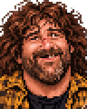 Otis Ward</td>
<td align="center"> Priya Gale</td>
<td align="center">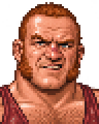 Red Doyle</td>
<td align="center"> Rex Titan</td>
<td align="center">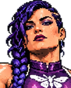 Rina Moss</td>
<td align="center">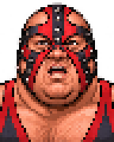 Rocco Flint</td>
</tr>
<tr>
<td align="center"> Roxy Rain</td>
<td align="center"> Sasha Wynn</td>
<td align="center"> Silas Rush</td>
<td align="center"> Sol Cruz</td>
<td align="center">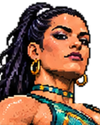 Soraya Idris</td>
<td align="center"> Sylvia Rook</td>
<td align="center"> The Reverend</td>
<td align="center"> Theo Voss</td>
</tr>
<tr>
<td align="center"> Tomas Keene</td>
<td align="center"> Tomás Ash</td>
<td align="center"> Tori Kade</td>
<td align="center">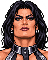 Val Vance</td>
<td align="center"> Vera Cho</td>
<td align="center"> Winnie March</td>
<td align="center">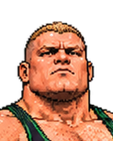 Zane Varley</td>
<td align="center"> Zara Finch</td>
</tr>
</table>
<!-- LIVING ROSTER END -->

*All portraits are the game's character artwork. The wrestlers, promotions and rivalries are fictional.*

## THE MAIN EVENT

*The latest issue · v0.65 · 23 November 2026*

### THE TERRITORY TALKS BACK

*The latest additions from the agents' room, the ring and the back pages.*

**A better reason for every phase of the fight.** The new **Match Structure Director** brings different dramatic patterns into live, signed match planning. Characters can haggle over a real named move; the match follows the agreement only where the wrestling permits it. Follow-up work gives selling, rest, counters, late offence and near falls more believable causes. [Match structures](https://github.com/southernadd-cmyk/wrestler/pull/194) · [Late-match work](https://github.com/southernadd-cmyk/wrestler/pull/220)

**Ringside calls that answer back.** **Hit the big spot** no longer demands an impossible move the instant you press the button. It can queue a legal opportunity and later report the move that really happened; an unfulfilled request is refunded. Other calls also distinguish what the wrestler actually did from what you merely asked for. [Ringside changes](https://github.com/southernadd-cmyk/wrestler/pull/242)

**The booking office has found its voice.** Promoters argue their case, offer real trade-offs and react differently to pressure. Dennis now makes the training desk more useful, with assessments, forecasts and a record of actual weekly development. There have also been practical changes to the old-school, Championship Manager-style navigation and management screens. [Negotiation conversations](https://github.com/southernadd-cmyk/wrestler/pull/184) · [Training](https://github.com/southernadd-cmyk/wrestler/pull/225)

**The body keeps score.** Wrestlers age between seasons and can retire. Injuries now lead to decisions about full recovery, early return or working through the pain, while repeated damage to the same body part can lengthen the layoff. There is no risk-free shortcut. [Ageing](https://github.com/southernadd-cmyk/wrestler/pull/252) · [Injury choices](https://github.com/southernadd-cmyk/wrestler/pull/256)

### RINGFAX

*From our teletext correspondent: page 100 is where the news starts.*

There's a **Ceefax-inspired wrestling service** inside the game. Ringfax carries editorial headlines, rumours, reports, fan letters and title talk drawn from your actual career. It's the voice of the circuit, **not a duplicate of the booking sheets or champions screen**. Its presentation is still being refined.

For those who know their **World of Sport** from their **King's Road**, the hidden **page 777 quiz** uses four coloured Teletext answers, checkpoints and a library of **192 different wrestling questions**. Each of the **16 weeks** in a season deals 12 new questions, with no repeats that season. The material covers wrestlers, moves, tags, match types, personalities, women's wrestling and notable UK careers abroad — not just championship trivia. [Ringfax editorial work](https://github.com/southernadd-cmyk/wrestler/pull/243) · [Weekly quiz](https://github.com/southernadd-cmyk/wrestler/pull/257)

## BACK ISSUES

*The old reports are still on file. They no longer interrupt the current issue.*

| Edition | Main story |
| --- | --- |
| **v0.65** · 23 Nov 2026 | **The Territory Talks Back** — match structures, better ringside decisions, career depth and Ringfax. [Main Event](#the-main-event). |
| **v0.6.0** · 21 Nov 2026 | **Earn the Finish** — five distinct match plans, legitimate near falls and earned long-match recovery. [Release guide](docs/v0.6-release.md). |
| **v0.5.0** · 20 Nov 2026 | **Every Hold Has a History** — richer grappling, technical identities and legal transitions. [Release guide](docs/v0.5-release.md). |
| **v0.4.0** · 19 Nov 2026 | **The Wrestling Knows Its Way Around** — foundational authored graph and technical styles. [Release guide](docs/v0.4-release.md). |

Older technical notes, frozen match simulations and archived audits are in the [documentation index](docs/README.md). These are development records, not a prerequisite to playing the game.

### THE SMALL PRINT

The game plays directly in the browser, without a build step or runtime service. Code is available under the [MIT License](LICENSE); original writing, characters, portraits, artwork and branding have separate rights. See [Content and copyright](CONTENT-LICENSE.md).

### THE OFFICE ONLINE

**Play:** [theoffice.repos.one](https://theoffice.repos.one/).

Careers save in the browser. If you played at the previous GitHub Pages address, export your career there from **Game → Save and load → Export save** before moving, then use **Import save** here. Browser saves do not move between addresses automatically.

