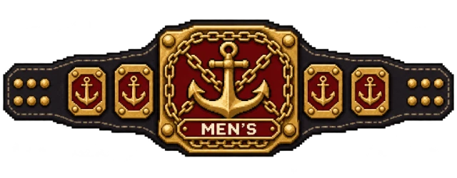
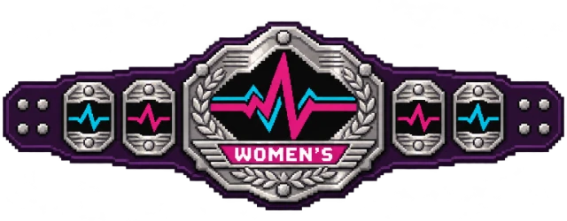
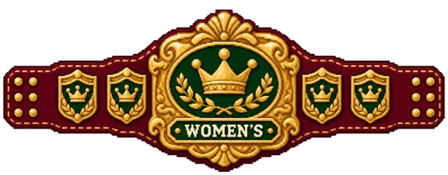
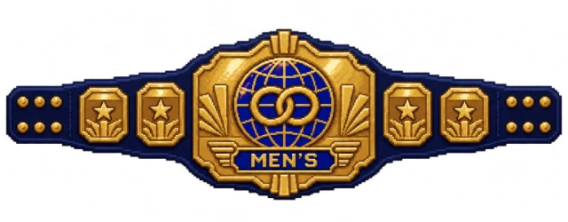
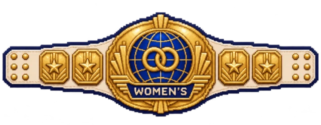
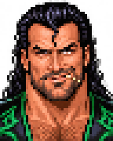
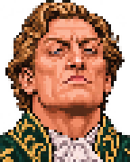
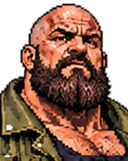

<p align="center">
  
</p>

<p align="center"><strong>ISSUE v0.3.10</strong> &nbsp; • &nbsp; 17 NOVEMBER 2026 &nbsp; • &nbsp; CHAMPIONSHIP EDITION</p>

<p align="center">
  <strong><a href="https://southernadd-cmyk.github.io/wrestler/">ENTER THE OFFICE — PLAY THE GAME</a></strong>
  &nbsp; · &nbsp; <a href="docs/architecture.md">Inside the engine</a>
  &nbsp; · &nbsp; <a href="#back-issues">Back issues</a>
</p>

<p align="center"></p>

<p align="center"></p>

## THE BELTS ARE ON THE TABLE

*Lead story*

Every promotion now runs two rankings: a **men’s division** and a **women’s division**, each with its own **championship**. That is eight belts across the circuit, and every one of them can change hands. Matches stay within a division, from the offers on your desk to the results that come in from the other towns.

Get one of your wrestlers to the top of a division’s main event and that promoter will offer a **title match** against the champion. As ever, the booker decides the result before you sign. Win the belt and the defences start coming in. Champions you don’t manage defend it every few weeks in the circuit results, and a belt whose holder leaves the promotion is handed to whoever tops the ranking. Careers that started before the belts get them the first time they load: each goes to whoever leads that division.

<table align="center">
<tr>
<td align="center"><br><sub>Dockside Men’s</sub></td>
<td align="center"><br><sub>Dockside Women’s</sub></td>
</tr>
<tr>
<td align="center"><br><sub>Pulse Underground Men’s</sub></td>
<td align="center"><br><sub>Pulse Underground Women’s</sub></td>
</tr>
<tr>
<td align="center"><br><sub>North Crown Men’s</sub></td>
<td align="center"><br><sub>North Crown Women’s</sub></td>
</tr>
<tr>
<td align="center"><br><sub>Grand Union Men’s</sub></td>
<td align="center"><br><sub>Grand Union Women’s</sub></td>
</tr>
</table>
<p align="center"><sub><em>FROM THE PICTURE DESK:</em> The eight championships, two for each promotion.</sub></p>

## ALSO IN THIS ISSUE

- **Every wrestler talks like themself.** All 80 wrestlers have their own lines in the agents’ room and at the microphone, written from their own story.
- **One thing leads to another backstage.** Some of Dennis’s situations now start something later in the meeting, and some come back at a later show. Promise somebody the big spot next time and they will hold you to it. Twenty-one new situations and follow-ups join the pool.
- **Six new ways to work the microphone.** Insult the town, do the maths, admit what the feud is doing to you, tease a surprise that never comes, say how you want to be remembered, or thank the room like it might be the last time.
- **Any other business.** Every wrestler on the roster has their own daft idea for their walk to the ring, from a pallet truck to an abseil down the climbing wall.
- **Tonight’s poster.** The start screen is now the bill for tonight’s show, with a different main event every time you open the game. With a saved career, your top wrestler headlines.
- **Version numbers start with a nought.** The game is still in development, so this is issue v0.3.10.

<p align="center"></p>

## A NEW FLOOR PLAN FOR THE OFFICE

*Production desk*

The entire territory used to work out of one **973 KB** HTML file. The front door is now just **4.6 KB**: the match engine, career, rivals, memory, promos, living-roster contracts and screens now sit in ordered JavaScript files, with separate stylesheets and a pixel-art portrait atlas. It is still the same browser game, served directly from GitHub Pages, with **no build step or runtime dependencies**. Match rules and existing career saves are unchanged.

Dennis has also rearranged the agents’ room. On wide desktop screens, his conversation and the running-order board sit side by side with independent scrolling. On smaller screens they stack, keeping the plan readable while the wrestlers have their say. The regression suite now tests the same scripts the browser loads, in the same order, rather than reading a giant inline script from `index.html`. [See the technical floor plan](docs/architecture.md).

<p align="center"></p>

## THE LIVING ROSTER

*From the picture desk*

All 80 wrestlers, together in one roster. Each has a named pixel-art portrait.

<!-- LIVING ROSTER START -->
<table align="center">
<tr>
<td align="center"><br><sub>Ace Cassidy</sub></td>
<td align="center"><br><sub>Aisha Moreno</sub></td>
<td align="center"><br><sub>Alina Fox</sub></td>
<td align="center"><br><sub>Anya Ortez</sub></td>
<td align="center"><br><sub>Ari Keats</sub></td>
<td align="center"><br><sub>Ash Carter</sub></td>
<td align="center"><br><sub>Ayla Bay</sub></td>
<td align="center"><br><sub>Bao Merrick</sub></td>
</tr>
<tr>
<td align="center"><br><sub>Bashir Lowe</sub></td>
<td align="center"><br><sub>Brick Mercer</sub></td>
<td align="center"><br><sub>Brontë Hayes</sub></td>
<td align="center"><br><sub>Cal Rourke</sub></td>
<td align="center"><br><sub>Cass Rae</sub></td>
<td align="center"><br><sub>Cedric Bloom</sub></td>
<td align="center"><br><sub>Cleo Watt</sub></td>
<td align="center"><br><sub>Dax Hollis</sub></td>
</tr>
<tr>
<td align="center"><br><sub>Dean Blackwell</sub></td>
<td align="center"><br><sub>Dee Okafor</sub></td>
<td align="center"><br><sub>Dev Hart</sub></td>
<td align="center"><br><sub>Eira Solis</sub></td>
<td align="center"><br><sub>Ellis Quade</sub></td>
<td align="center"><br><sub>Elodie Quinn</sub></td>
<td align="center"><br><sub>Emmett Briggs</sub></td>
<td align="center"><br><sub>Ezra Quill</sub></td>
</tr>
<tr>
<td align="center"><br><sub>Faye Calder</sub></td>
<td align="center"><br><sub>Felix Orr</sub></td>
<td align="center"><br><sub>Gideon Frost</sub></td>
<td align="center"><br><sub>Gus Marr</sub></td>
<td align="center"><br><sub>Imani King</sub></td>
<td align="center"><br><sub>Iris Vaughan</sub></td>
<td align="center"><br><sub>Ivo Serrano</sub></td>
<td align="center"><br><sub>Jett Harlow</sub></td>
</tr>
<tr>
<td align="center"><br><sub>Jun Park</sub></td>
<td align="center"><br><sub>Juno Stark</sub></td>
<td align="center"><br><sub>Kellan Ryu</sub></td>
<td align="center"><br><sub>Kezia North</sub></td>
<td align="center"><br><sub>Kira Sato</sub></td>
<td align="center"><br><sub>Kit Marlowe</sub></td>
<td align="center"><br><sub>Kofi Hale</sub></td>
<td align="center"><br><sub>Leandro Moya</sub></td>
</tr>
<tr>
<td align="center"><br><sub>Liya Fen</sub></td>
<td align="center"><br><sub>Lyra Knox</sub></td>
<td align="center"><br><sub>Mae Okoro</sub></td>
<td align="center"><br><sub>Magnus Graves</sub></td>
<td align="center"><br><sub>Malik Knight</sub></td>
<td align="center"><br><sub>Mara Vale</sub></td>
<td align="center"><br><sub>Marisol Tide</sub></td>
<td align="center"><br><sub>Milo Ember</sub></td>
</tr>
<tr>
<td align="center"><br><sub>Miro Lane</sub></td>
<td align="center"><br><sub>Morgan Alder</sub></td>
<td align="center"><br><sub>Nadia Park</sub></td>
<td align="center"><br><sub>Nate Barr</sub></td>
<td align="center"><br><sub>Nico Vega</sub></td>
<td align="center"><br><sub>Night Shift</sub></td>
<td align="center"><br><sub>Nikita Rowe</sub></td>
<td align="center"><br><sub>Noelle Stroud</sub></td>
</tr>
<tr>
<td align="center"><br><sub>Nolan Pike</sub></td>
<td align="center"><br><sub>Nova Bell</sub></td>
<td align="center"><br><sub>Otis Ward</sub></td>
<td align="center"><br><sub>Priya Gale</sub></td>
<td align="center"><br><sub>Red Doyle</sub></td>
<td align="center"><br><sub>Rex Titan</sub></td>
<td align="center"><br><sub>Rina Moss</sub></td>
<td align="center"><br><sub>Rocco Flint</sub></td>
</tr>
<tr>
<td align="center"><br><sub>Roxy Rain</sub></td>
<td align="center"><br><sub>Sasha Wynn</sub></td>
<td align="center"><br><sub>Silas Rush</sub></td>
<td align="center"><br><sub>Sol Cruz</sub></td>
<td align="center"><br><sub>Soraya Idris</sub></td>
<td align="center"><br><sub>Sylvia Rook</sub></td>
<td align="center"><br><sub>The Reverend</sub></td>
<td align="center"><br><sub>Theo Voss</sub></td>
</tr>
<tr>
<td align="center"><br><sub>Tomas Keene</sub></td>
<td align="center"><br><sub>Tomás Ash</sub></td>
<td align="center"><br><sub>Tori Kade</sub></td>
<td align="center"><br><sub>Val Vance</sub></td>
<td align="center"><br><sub>Vera Cho</sub></td>
<td align="center"><br><sub>Winnie March</sub></td>
<td align="center"><br><sub>Zane Varley</sub></td>
<td align="center"><br><sub>Zara Finch</sub></td>
</tr>
</table>
<!-- LIVING ROSTER END -->

**The Office** is a text-led wrestling management game played in the browser. You look after one regional stable. Bookers call the result, then you and the wrestlers work out how to get there. Backstage, people remember who took the clean loss, who broke their word, and who made the other wrestler look good in front of a quiet room.

### Around the towns

| Promotion | What the booker wants | Main-event names at the start |
| --- | --- | --- |
| **Dockside** | A brawl that makes the warehouse crowd sit up. | Rocco Flint, Red Doyle |
| **Pulse Underground** | A big spot worth passing around after the show. | Night Shift, Ace Cassidy |
| **North Crown** | A story the regional television audience can follow. | The Reverend, Roxy Rain |
| **Grand Union** | Technical work on the national broadcast. | Silas Rush, Nova Bell |

Each booker keeps a separate card, from opener to main event, with a men’s and a women’s ranking and a champion at the top of each. A result at Dockside goes on Dockside’s record. Repeat appearances can raise your fee there, and an established draw can bring higher billing. See who’s up, who’s down and who’s working elsewhere in **Territory → Card pyramid**.

**Rival stable report.** Mo Devlin starts with nine at Iron Borough, Ruth Anwar has eight at Gold Coast, and Len Mercer has eight at North Circuit. Three more managers are on the road: Dina Kestrel at Eastbank Athletic (six wrestlers), Pavel Singh at Meridian International (six), and Cleo Kells at Redwood Wrestling Agency (seven). Their results, wages, signings and releases change the circuit from week to week. If one of your wrestlers takes a rival’s offer, you may find yourself booking against them.

---

<p align="center"></p>

## FIRST WEEK WITH DENNIS

*From the road agent*

The start screen is tonight’s fight poster, and **New career** still takes you straight to Free agents. Dennis gives you an in-game welcome before the figures take over. A collapsible **First Week** guide stays within reach while you sign a wrestler, book a match, read your inbox, choose a training focus and work your first bout. Steps update from what you actually do; they are not scripted gates. The guide folds away after the first week and can be reopened from **Game → How a week works**. Its state lives inside the normal career save, including older careers.

## FROM THE BOOKING OFFICE

*First week on the job*

You get **£2,250**, an empty locker room and four promoters with different ideas about what a good match looks like. There are **16 weeks to a season**, room for **five contracts**, and **two management meetings a week**. The wages come due whether you’ve booked a match or spent the week waiting for the phone.

1. Open the [game](https://southernadd-cmyk.github.io/wrestler/) and pick **New career**. It opens at **Roster → Free agents**. Check the signing fee, the weekly wage and what the wrestler does well before you sign anyone.
2. Look under **Bookings → Offers**. The booker sets the spot on the card, the purse and the finish. You can negotiate the rate, ask for higher billing or try to protect a clean loss.
3. Read the **Office** inbox. Promoter requests, injuries and backstage problems can all need a decision. Set training in **Roster** and keep an eye on fatigue and upcoming fixtures.
4. Press **Continue** when the paperwork is in order. A booked card takes you backstage with Dennis. From there you’ll go to the microphone and on to ringside. If the promo gets cut, you’ll go straight to the bell.
5. Read the match report and check what ended up in **Territory → Results**. A good showing can build a programme. A promise you missed can come back to the office with you.

The desktop layout keeps **Office**, **Roster**, **Bookings**, **Territory** and **Game** in the sidebar, with back and forward buttons at the top. Wrestler and free-agent lists are sortable. On a smaller screen the panels stack vertically.

## A WORD WITH DENNIS

*Training ground*

Training still runs on a weekly focus and intensity, with blocks, camps and a specialist coach. On top of that, a wrestler can spend **a session with Dennis**. He has time for **two sessions a week across the whole stable**, so somebody always misses out.

- **Rehearse for the next match.** The wrestler walks into the agents’ room keener, Dennis tells the room they’ve been through it, and they stick closer to the running order in the ring. One rehearsal lasts two weeks or one match.
- **Learn a big-spot move.** Each wrestler has up to three moves that suit their style and their body. Two weeks for a safe one, three for a risky one, paused when they’re exhausted. Once learned, it’s the move they pitch for the big spot, marked *Learned in training*.
- **Mic work.** Practise one style of opening. A practised style suits the wrestler better at the microphone, Dennis mentions it in his read, and it fades if it isn’t kept up.

Dennis suggests a session for each wrestler from their last report: a rehearsal after a match that drifted from the match layout, mic work after losing the room, a move for somebody with no big spot of their own. Set sessions in **Roster → Training** or on a wrestler’s profile.

<p align="center"></p>

## THE FIGURES

*Statistics desk*

The office keeps its own records now, and draws them. **Desk → This week** shows the bank balance against the weekly bill. **Territory → Results** charts every match the stable has worked this season, wrestler by wrestler. Each **wrestler profile** shows their ring, mic, psychology and safety week by week, and their star ratings match by match. The **match report** draws the crowd through the bout, with every beat of the running order marked where it landed, changed or slipped away.

<p align="center"></p>

## TEN MINUTES TO DOORS

*From the agents’ room*

Road agent Dennis starts with the booked result and asks how you want the match to work. Then he hands you **the running order**: the shine, the heat, the comeback and the big spot, already pencilled in. Each beat has two or three pitches beside it — one from each wrestler and Dennis’s middle-of-the-road option — and you can swap any of them before you agree it. Dennis tells you whether the order tells a story the booked finish can pay off. A clean loser with the big spot, or a comeback from nothing, will get a look.

Then two or three situations come up from a pool of 36, and they push on the plan you’ve just agreed. The pairing, the promotion, the card position and the terms help decide what comes through the door. A wrestler might pitch a risky move, the booker might ask for four more minutes, or a scout might turn up in row F.

A situation can change a beat (the card will say *Changes the heat*), and some decisions rule moves out altogether. Stay away from the soft corner, or keep everyone off a slack top rope, and Dennis rubs out whatever no longer works and pencils in the nearest thing that does. Read the choice cards for the stakes. A decision can change the starting crowd, the purse, trust, morale, match length or how much risk the wrestlers take. Their moods and the agreed plan stay on screen. Choose the route to the booked result and give them a last word at the curtain. The signed sheet carries the whole running order into the match, with a legal alternative for each beat in case the wrestlers need to call an audible. How faithfully they follow it depends on how they feel about it, how tired they are, how good they are at keeping a match on track and whether the room is giving anything back. Happy, fresh wrestlers land about nine agreed beats in ten. A pair who are sulking land about four. Landed beats lift the star rating, more so when the order tells a story; missed ones cost you.

**One thing leads to another.** Some answers start something. Trust the stand-in referee and he’ll be back with a question. Let your wrestler show off for a rival manager and they’ll be tapped up by the fire exit. Others come back at a later show: promise somebody the big spot *next time*, tell a hurt wrestler to walk it off, or put off a money talk, and it opens the next meeting with them. Take a time cut without a fuss and that promoter owes you a favour. Choice cards that do this say *Comes back next time*.

**Any other business.** At the end of the meeting somebody usually has an idea for their entrance. Every wrestler has one of their own, so it is the Legion bugler for one and a borrowed pallet truck for another. Say yes and it goes down a storm or goes wrong in front of everyone.

## THE MIC IS OPEN

*Pre-match report*

Before the first line, Dennis gives you **his read**: whether the room is hot, quiet or doesn’t know your wrestler, whether there’s real history between the two, whether the opponent can talk, and what sort of talker your wrestler is. No opening is right every night. A quiet room punishes shouting, an accusation with no history sounds made up, and a big strange picture only works for somebody who can carry it. Choose the line that suits the night and it lands more often and counts for more. The risky lines are the big ones when the night is right for them.

**Six more ways to talk.** Some nights also offer an opening that **insults the town** or **does the maths** (badly, with total confidence); an answer that **admits what this is doing to you** or **teases a surprise** that never arrives; and a last word that says **how you want to be remembered** or **thanks the room like it might be the last time**. They only appear when they suit the night, and the two new last words promise nothing the match has to check. Every wrestler says it in their own words.

Start with **Opening shot**, then take the mic back in **They hit back**. When the opponent replies, they take an angle — personal, mocking, armed with facts, or playing to the crowd — and the commentary tells you which. Each angle has an answer that beats it: keep your composure against the personal stuff, turn the words round on somebody laughing at you, ask for an answer in the ring when they quote the record. At **Push your luck?**, you can leave the exchange there or go after the crowd again. Going again pays when the room is already with you and the gamble suits the speaker. Otherwise, walk away. Playing to the town is a small lift. A good joke can win the room, and a bad one can give it away. A live meter follows every swing, with both wrestlers’ lines and the crowd’s reactions on screen.

**Last word** is where a vow can follow you into the ring. Promise to counter a particular attack and the match looks for the relevant reversal. Name a finisher and a sharp opponent can scout it. Demand a clean bout and the wrestlers are steered away from dirty tactics. Check the warnings on each choice if the booked result makes the vow difficult to keep. A promise to counter, or to win with the finisher, goes onto the match strip as a **Vow** in its own lane, and is settled at the bell. A promise the booking already guarantees — a win when you’re booked to win — is marked *Safe bet, small reward*, and keeping it earns little.

## RINGSIDE AND AFTER THE BELL

*Match report*

Under the scoreboard, **the match strip** lays the running order along the clock: two lanes of beats, each sitting in the stretch of the match where it’s due, edged gold for your wrestler and white for theirs. A white playhead moves across as the bell time ticks on. A beat lights up when its window opens, turns green when it lands, amber when the wrestlers call an audible and red when the chance passes. A notch marks the moment it happened. Hover for the detail.

The bout runs in original text commentary. Style, size, stamina, damage and position shape the action. A comeback needs a change of control. A dangerous spot needs the right setup. A near-fall needs a credible move and a cover. The booked winner remains the plan, with exceptional ringside decisions such as a stoppage handled explicitly.

| At ringside | Control |
| --- | --- |
| Pause or resume | **Space** |
| Make one of the current ringside calls | **1–6** or the matching on-screen button |
| Resolve a decision prompt | Pick one of the choices on screen |

The report compares the signed board with the match, starting with the strip as it stood at the bell. It shows beats performed, adapted or missed, plus the effect on the crowd, purse and promoter. Wrestlers carry significant incidents into later conversations and matches. A humiliating loss, an injury, a protected finish or a broken promise can all matter next time. Rex Titan may want a word after a clean loss. If you promise him a featured match, check the fixture list before you say it.

## KEEP YOUR COPIES

*Save desk*

The browser saves your career automatically, including backstage meetings, promos and live bouts in progress. Use **Game → Export save** for a portable career copy and **Game → Import save** to pick up elsewhere. In-progress match night is stored in the browser you played it in. A local copy and the hosted game use separate browser storage, as do different browsers or devices.

Earlier supported v0.2-era careers can still be loaded. Career progress carries into v0.3.10, and older careers pick up the eight belts on their first load. If you upgrade halfway through a v0.3.5 backstage meeting or promo, or a v0.3.6 backstage meeting, that segment starts again in the new format.

To play locally, download the **whole repository** and open `index.html` in a modern browser. Keep the `assets/` directory alongside it: the page loads the JavaScript, CSS and portrait atlas as separate files. The simulation still runs in the browser, with no installer or build step. Google Fonts load when available, with system fallbacks.

---

## BY THE NUMBERS

*Engine desk*

| What’s in the match layout | Current count |
| --- | ---: |
| In-ring actions and events (nodes) | 969 |
| Links between actions and events (transitions) | 6,152 |
| Match story arcs | 25 |
| Routes across the four booked finishes | 18 |
| Authored moves and move families | 336 / 20 |
| Promo graph angles and situational variants | 21 / 183 |
| Backstage situations and follow-ups | 36 / 9 |
| Championship belts | 8 |
| Wrestlers with lines of their own | 80 |
| Entrance ideas, personal and shared | 80 / 32 |
| Rounds in the promo duel | 4 |

The match graph and career simulation use seeded logic so a saved sequence can be resumed deterministically. Reversals and applicable blocks sit alongside the authored moves. Narration and wrestler dialogue are original, informed by match structure, performer interviews and wrestling history. [Match graph and research](docs/match-graph.md) · [Promo research](docs/promo-graph.md)

### Source files

The game is now structured as a small HTML entry point, ordered JavaScript modules in `assets/js/`, CSS files in `assets/css/`, and a separate portrait atlas PNG. It stays a static GitHub Pages game with **no build step**. See the [architecture guide](docs/architecture.md) and run all tests with `npm test` or `node tests/run-tests.cjs`.

### On the record

Node.js is needed for the regression suites only. From the repository root, run any of the following:

```sh
node tests/roster.test.cjs
node tests/portrait-art.test.cjs
node tests/world-v4.test.cjs
node tests/agents-room.test.cjs
node tests/season-soak.test.cjs
node tests/match-flow.test.cjs
node tests/graph-flow.test.cjs
node tests/match-variety.test.cjs
node tests/graph-sheet.test.cjs
node tests/creative-loop.test.cjs
node tests/memory-flow.test.cjs
node tests/promo-flow.test.cjs
node tests/promo-variants.test.cjs
node tests/promo-read.test.cjs
node tests/training-sessions.test.cjs
node tests/records.test.cjs
node tests/catalog.test.cjs
node tests/divisions.test.cjs
node tests/voices.test.cjs
node tests/room-chains.test.cjs
node tests/promos-requests.test.cjs
node tests/structure.test.cjs
```

The suites cover the free-agent market and rival contracts, separate promotion ladders, divisions and title changes, older saves, backstage situations and their follow-ups, personal voices, signed boards, booked finishes, match legality, the promo duel and repeatable careers.

**Continuous integration:** All 26 suites, including the modular-source structure check, run automatically on pushes and pull requests using Node.js 22 in [GitHub Actions](.github/workflows/tests.yml). A red test run means the submitted commit failed validation. To require green checks before merge, configure the repository's branch protection/ruleset for the `Regression suite (Node 22)` status check.

### Small print

The software implementation (HTML/CSS/JavaScript source and test code) is available under the [MIT License](LICENSE). The game's original writing, dialogue, characters, portraits, artwork, branding and other creative content are **not** licensed for reuse under MIT, including creative material held in the separate `assets/` files. See [Content and copyright](CONTENT-LICENSE.md) for the distinction. Third-party material remains subject to its own licences.

<p align="center"></p>

## BACK ISSUES

*From the files*

| Edition | What was reported |
| --- | --- |
| **v0.3.10** | Six new ways to work the microphone, from insulting the town to thanking the room, offered when they suit the night. Every wrestler gets their own daft entrance idea, and the original 28 get their own voices too, so all 80 speak in their own words. The start screen becomes tonight’s fight poster. Version numbers move to the pre-release 0.x scheme. |
| **v0.3.9** | Championship edition. Every promotion splits into men’s and women’s divisions with eight belts won and lost in title matches. The 52 newcomers speak in their own words. Backstage choices start chains within a meeting and threads that return at later shows, with 21 new situations and follow-ups. |
| **v0.3.8.1** | The production desk is rebuilt: 11 JavaScript files, four stylesheets and a separate portrait atlas replace the giant HTML file. The agents’ room gets independent scrolling columns on desktop and a stacked plan on smaller screens. Tests now run against the scripts that ship to players, while existing saves and match rules stay intact. |
| **v0.3.8** | Charts on the desk, the results, every profile and every match report. The running order is three across on a phone, and the training table fits a laptop screen. Sessions with Dennis. Two a week across the stable: rehearse for the next match, learn a big-spot move, or work on one style at the microphone. Each feeds straight into the agents’ room, the promo or the ring. |
| **v0.3.7** | The planning spine. Every match night has a running order of four beats that you can change, Dennis judges whether it tells a story, situations rewrite beats they rule out, and the wrestlers’ mood and condition decide how much of it actually happens. The match strip shows the running order on the clock as it plays out, and again on the report. At the microphone, Dennis reads the night first, opponents take an angle you can answer, pushing your luck can pay, and counter and finisher vows go on the strip. |
| **v0.3.6** | Dennis opens match night with a changing set of backstage decisions. The promo becomes a duel for the crowd, with a chance to push your luck before the last word. |
| **v0.3.5** | Dennis opens the agents’ room and the microphone goes live. The roster and territory edition doubles the cast, brings in the new portraits and gives all four bookers cards of their own. |
| **v0.3.4** | The narration gets a line edit, signature moves belong to individuals and a full-season test goes through the books. The 400-bout balance audit put the average at 2.04 stars and missed beats at 21%. |
| **v0.3.3** | The action catalog grows to 336 moves with distinct counters and physical limits. The promo desk adds replies grounded in the actual pairing. [Expansion notes](docs/graph-expansion-v3-3.md) |
| **v0.3.2** | The two wrestlers start pitching what the match ought to prove. A promo promise can turn into a real tactical commitment. [Creative meetings and microphone promises](docs/creative-loop-v3-2.md) |
| **v0.3.1** | Negotiated beats become a signed sheet with timing, a wrestler responsible for each beat and legal alternatives. The report distinguishes a missed beat from one the wrestlers rebuilt. [Match-sheet notes](docs/graph-sheet-v3-1.md) |
| **v0.3.0** | The locker room gets a memory. Protected losses, humiliations, injuries and promises follow a wrestler into the next show. [Wrestler memory](docs/wrestler-memory.md) |
| **v0.2.9** | Individual repertoires, credible size and stamina limits, and opponent scouting give wrestlers a recognisable way of working. [Match variety](docs/match-variety.md) |
| **v0.2.8** | The original three-part promo exchange introduces opponent replies, public promises and a saved transcript. |
| **v0.2.7** | Match commentary moves onto connected story, action and outcome graphs. |
| **v0.2.6** | Match psychology gets explicit control changes, body-part work and setups for the bigger spots. |

[Unabridged development archive](https://github.com/southernadd-cmyk/wrestler/blob/3fc3f5eaaef2203e65dfb5ed3ec91075f27a5d6f/readme.md) · [Original sumo game archive](https://github.com/southernadd-cmyk/wrestler/tree/archive/sumo-before-the-office-2026-11-11)

<details>
<summary>Match research from the early issues</summary>

- [Matt Murphy on match structure](https://missouriwrestlingrevival.com/2009/12/23/chapter-15-match-structure-by-matt-murphy/)
- [WWE retrospective on Savage vs Steamboat](https://www.wwe.com/inside/listthis/maniamatches/maniamatches7)
- [Action and control analysis of Hart vs Austin](https://www.prowrestlingmusings.com/post/greatest-matches-of-all-time-bret-hart-vs-steve-austin)
- [Bayley vs Banks and the use of injury callbacks](https://www.cagesideseats.com/wwe/2016/7/25/12264730/making-history-bayleys-journey-part-5)

</details>

<p align="center"></p>

*Layout references* · [Pro Wrestling Torch print covers](https://www.pwtorch.com/artman2/publish/wadekellerdotcom/46258.shtml) · [Wrestling Observer back issues](https://www.f4wonline.com/news/daily-updates/first-decade-wrestling-observer-hall-of-fame-issues-special-157576/)
