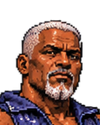
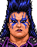
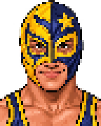
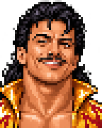
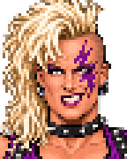
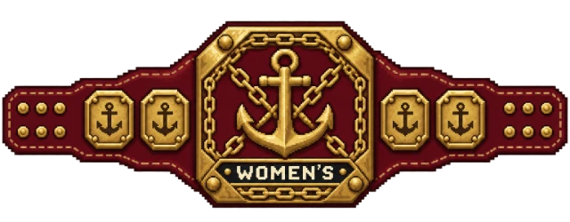
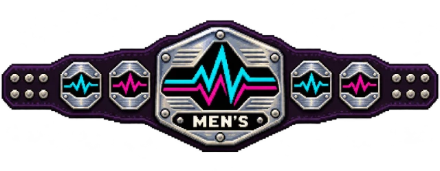
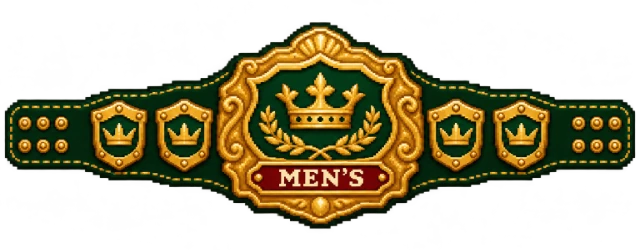

<p align="center">
  
</p>

<p align="center"><strong>ISSUE v0.5.0</strong> &nbsp; • &nbsp; 20 NOVEMBER 2026 &nbsp; • &nbsp; EVERY HOLD HAS A HISTORY EDITION</p>

<p align="center">
  <strong><a href="https://southernadd-cmyk.github.io/wrestler/">ENTER THE OFFICE — PLAY THE GAME</a></strong>
  &nbsp; · &nbsp; <a href="docs/architecture.md">Inside the engine</a>
  &nbsp; · &nbsp; <a href="#back-issues">Back issues</a>
</p>

<p align="center"></p>

<p align="center">
  <a href="#how-to-play">How to play</a> &nbsp; · &nbsp; <a href="#the-living-roster">Living roster</a> &nbsp; · &nbsp; <a href="#the-territory">Territory</a> &nbsp; · &nbsp; <a href="#match-night">Match night</a> &nbsp; · &nbsp; <a href="#the-latest-issue">Latest issue</a> &nbsp; · &nbsp; <a href="#back-issues">Archive</a>
</p>

<p align="center"></p>

## HOW TO PLAY

**The matches are scripted. The people aren't.**

You run a small regional wrestling stable. Four promoters control their cards and decide the booked winners; you sign wrestlers, negotiate their appearances, work out a match with road agent Dennis, handle the microphone and live with what happens after the bell. Winning every bout isn't the goal. Building a stable that stays in work, earns trust and survives the politics is.

### FIRST WEEK WITH DENNIS

*From the road agent*

The start screen is tonight’s fight poster, and every match on it is real: with a saved career it bills your next booked match, and without one it bills a match from the first circuit show a new career will put on. **New career** still takes you straight to Free agents. Dennis gives you an in-game welcome before the figures take over. A collapsible **First Week** guide stays within reach while you sign a wrestler, book a match, read your inbox, choose a training focus and work your first bout. Steps update from what you actually do; they are not scripted gates. The guide folds away after the first week and can be reopened from **Game → How a week works**. Its state lives inside the normal career save, including older careers.

### FROM THE BOOKING OFFICE

*First week on the job*

You get **£2,250**, an empty locker room and four promoters with different ideas about what a good match looks like. There are **16 weeks to a season**, room for **five contracts**, and **two management meetings a week**. The wages come due whether you’ve booked a match or spent the week waiting for the phone.

1. Open the [game](https://southernadd-cmyk.github.io/wrestler/) and pick **New career**. It opens at **Roster → Free agents**. Check the signing fee, the weekly wage and what the wrestler does well before you sign anyone.
2. Look under **Bookings → Offers**. The booker sets the spot on the card, the purse and the finish. You can negotiate the rate, ask for higher billing or try to protect a clean loss. Once a promoter trusts you, some offers are whole **programmes**: several dated matches signed as one. Don’t sit on a good offer for too long; a rival manager may get it instead.
3. Read the **Office** inbox. Promoter requests, injuries and backstage problems can all need a decision. Set training in **Roster** and keep an eye on fatigue and upcoming fixtures.
4. Press **Continue** when the paperwork is in order. A booked card takes you backstage with Dennis. Set the running order, any programme chapter and the ringside plan. From there it is the microphone (perhaps with a mouthpiece), or a contract signing on a big night, and then the bell. If the promo gets cut, you go straight to the match.
5. Read the match report, play out the plan **after the bell**, and decide what your wrestler says on the microphone. Then check **Territory → Results**. A good showing can build a programme; a callout can bring next week’s offer, and a promise you missed can follow you back to the office.

The desktop layout keeps **Office**, **Roster**, **Bookings**, **Territory** and **Game** in the sidebar, with back and forward buttons at the top. Wrestler and free-agent lists are sortable. On a smaller screen the panels stack vertically.

**Saving:** Your career autosaves in the browser. Use **Game → Export save** for a portable copy; use **Import save** on another device or browser.

## THE LIVING ROSTER

*From the picture desk*

There are **80 wrestlers** in the living circuit, including the original 28 and 52 newer faces. Your stable starts empty, and you can sign up to **five**. The others work for rival managers, appear on promotion cards or become available to sign. They are not just a list of statistics: each has a voice, favourite moves, relationships, ambitions and a history that develops as the weeks pass.

**What to look for when signing:** ring, mic, psychology and safety ability; weekly wage and signing fee; condition and fatigue; what they want from their career; and how they will get on with the rest of the locker room. A wrestler who can work a good match is not necessarily the one who can sell it on the microphone.

The three kinds of development are distinct: **performance style** (Story, Technical, Brawl or Spectacle) shapes presentation; **technical background** influences eligible, reviewed move choices (40 of those backgrounds are provisional game characterisations); and **weekly training** improves practical readiness. Training does not permanently change technical school in v0.5.

<details>
<summary><strong>Meet all 80 wrestlers — open the portrait gallery</strong></summary>

<!-- LIVING ROSTER START -->
<table align="center">
<tr>
<td align="center"><br><sub>Ace Cassidy</sub></td>
<td align="center"><br><sub>Aisha Moreno</sub></td>
<td align="center"><br><sub>Alina Fox</sub></td>
<td align="center"><br><sub>Anya Ortez</sub></td>
<td align="center"><br><sub>Ari Keats</sub></td>
<td align="center"><br><sub>Ash Carter</sub></td>
<td align="center"><br><sub>Ayla Bay</sub></td>
<td align="center"><br><sub>Bao Merrick</sub></td>
</tr>
<tr>
<td align="center"><br><sub>Bashir Lowe</sub></td>
<td align="center"><br><sub>Brick Mercer</sub></td>
<td align="center"><br><sub>Brontë Hayes</sub></td>
<td align="center"><br><sub>Cal Rourke</sub></td>
<td align="center"><br><sub>Cass Rae</sub></td>
<td align="center"><br><sub>Cedric Bloom</sub></td>
<td align="center"><br><sub>Cleo Watt</sub></td>
<td align="center"><br><sub>Dax Hollis</sub></td>
</tr>
<tr>
<td align="center"><br><sub>Dean Blackwell</sub></td>
<td align="center"><br><sub>Dee Okafor</sub></td>
<td align="center"><br><sub>Dev Hart</sub></td>
<td align="center"><br><sub>Eira Solis</sub></td>
<td align="center"><br><sub>Ellis Quade</sub></td>
<td align="center"><br><sub>Elodie Quinn</sub></td>
<td align="center"><br><sub>Emmett Briggs</sub></td>
<td align="center"><br><sub>Ezra Quill</sub></td>
</tr>
<tr>
<td align="center"><br><sub>Faye Calder</sub></td>
<td align="center"><br><sub>Felix Orr</sub></td>
<td align="center"><br><sub>Gideon Frost</sub></td>
<td align="center"><br><sub>Gus Marr</sub></td>
<td align="center"><br><sub>Imani King</sub></td>
<td align="center"><br><sub>Iris Vaughan</sub></td>
<td align="center"><br><sub>Ivo Serrano</sub></td>
<td align="center"><br><sub>Jett Harlow</sub></td>
</tr>
<tr>
<td align="center"><br><sub>Jun Park</sub></td>
<td align="center"><br><sub>Juno Stark</sub></td>
<td align="center"><br><sub>Kellan Ryu</sub></td>
<td align="center"><br><sub>Kezia North</sub></td>
<td align="center"><br><sub>Kira Sato</sub></td>
<td align="center"><br><sub>Kit Marlowe</sub></td>
<td align="center"><br><sub>Kofi Hale</sub></td>
<td align="center"><br><sub>Leandro Moya</sub></td>
</tr>
<tr>
<td align="center"><br><sub>Liya Fen</sub></td>
<td align="center"><br><sub>Lyra Knox</sub></td>
<td align="center"><br><sub>Mae Okoro</sub></td>
<td align="center"><br><sub>Magnus Graves</sub></td>
<td align="center"><br><sub>Malik Knight</sub></td>
<td align="center"><br><sub>Mara Vale</sub></td>
<td align="center"><br><sub>Marisol Tide</sub></td>
<td align="center"><br><sub>Milo Ember</sub></td>
</tr>
<tr>
<td align="center"><br><sub>Miro Lane</sub></td>
<td align="center"><br><sub>Morgan Alder</sub></td>
<td align="center"><br><sub>Nadia Park</sub></td>
<td align="center"><br><sub>Nate Barr</sub></td>
<td align="center"><br><sub>Nico Vega</sub></td>
<td align="center"><br><sub>Night Shift</sub></td>
<td align="center"><br><sub>Nikita Rowe</sub></td>
<td align="center"><br><sub>Noelle Stroud</sub></td>
</tr>
<tr>
<td align="center"><br><sub>Nolan Pike</sub></td>
<td align="center"><br><sub>Nova Bell</sub></td>
<td align="center"><br><sub>Otis Ward</sub></td>
<td align="center"><br><sub>Priya Gale</sub></td>
<td align="center"><br><sub>Red Doyle</sub></td>
<td align="center"><br><sub>Rex Titan</sub></td>
<td align="center"><br><sub>Rina Moss</sub></td>
<td align="center"><br><sub>Rocco Flint</sub></td>
</tr>
<tr>
<td align="center"><br><sub>Roxy Rain</sub></td>
<td align="center"><br><sub>Sasha Wynn</sub></td>
<td align="center"><br><sub>Silas Rush</sub></td>
<td align="center"><br><sub>Sol Cruz</sub></td>
<td align="center"><br><sub>Soraya Idris</sub></td>
<td align="center"><br><sub>Sylvia Rook</sub></td>
<td align="center"><br><sub>The Reverend</sub></td>
<td align="center"><br><sub>Theo Voss</sub></td>
</tr>
<tr>
<td align="center"><br><sub>Tomas Keene</sub></td>
<td align="center"><br><sub>Tomás Ash</sub></td>
<td align="center"><br><sub>Tori Kade</sub></td>
<td align="center"><br><sub>Val Vance</sub></td>
<td align="center"><br><sub>Vera Cho</sub></td>
<td align="center"><br><sub>Winnie March</sub></td>
<td align="center"><br><sub>Zane Varley</sub></td>
<td align="center"><br><sub>Zara Finch</sub></td>
</tr>
</table>
<!-- LIVING ROSTER END -->

</details>

*Every portrait comes from the game's actual character art. [Read the living-roster design notes](docs/living-roster-v4.md).*

<p align="center"></p>

<p align="center"></p>

## THE TERRITORY

*Four promotions, their champions, their managers and the towns they fight over.*

### Around the towns

| Promotion | What the booker wants | How they book | Main-event names at the start |
| --- | --- | --- | --- |
| **Dockside** | A brawl that makes the warehouse crowd sit up. | Grudges first, short title chases, head to head with rivals. | Rocco Flint, Red Doyle |
| **Pulse Underground** | A big spot worth passing around after the show. | New stars, and the most surprises. | Night Shift, Ace Cassidy |
| **North Crown** | A story the regional television audience can follow. | Long title chases that pay off as planned. | The Reverend, Roxy Rain |
| **Grand Union** | Technical work on the national broadcast. | Rewards ability and lets champions reign. | Silas Rush, Nova Bell |

Each booker keeps a separate card, from opener to main event, with a men’s and a women’s ranking and a champion at the top of each. A result at Dockside goes on Dockside’s record. Repeat appearances can raise your fee there, and an established draw can bring higher billing. See who’s up, who’s down and who’s working elsewhere in **Territory → Card pyramid**, and what each booker is planning in **Territory → Booking sheets**.

**Rival stable report.** Mo Devlin starts with nine at Iron Borough, Ruth Anwar has eight at Gold Coast, and Len Mercer has eight at North Circuit. Three more managers are on the road: Dina Kestrel at Eastbank Athletic (six wrestlers), Pavel Singh at Meridian International (six), and Cleo Kells at Redwood Wrestling Agency (seven). Their results, wages, signings and releases change the circuit from week to week, and each of them pushes their own wrestlers with the bookers (see [The other managers](#the-other-managers)). Their rosters, faces and moods are in **Roster → Rival stables**. If one of your wrestlers takes a rival’s offer, you may find yourself booking against them.

### THE BELTS ARE ON THE TABLE

*Championship desk*

Every promotion now runs two rankings: a **men’s division** and a **women’s division**, each with its own **championship**. That is eight belts across the circuit, and every one of them can change hands. Matches stay within a division, from the offers on your desk to the results that come in from the other towns.

Get one of your wrestlers to the top of a division’s main event and that promoter will offer a **title match** against the champion. As ever, the booker decides the result before you sign. Win the belt and the defences start coming in. Champions you don’t manage defend it every few weeks in the circuit results, and a belt whose holder leaves the promotion is handed to whoever tops the ranking. Careers that started before the belts get them the first time they load: each goes to whoever leads that division.

<table align="center">
<tr>
<td align="center"><br><sub>Dockside Men’s</sub></td>
<td align="center"><br><sub>Dockside Women’s</sub></td>
</tr>
<tr>
<td align="center"><br><sub>Pulse Underground Men’s</sub></td>
<td align="center"><br><sub>Pulse Underground Women’s</sub></td>
</tr>
<tr>
<td align="center"><br><sub>North Crown Men’s</sub></td>
<td align="center"><br><sub>North Crown Women’s</sub></td>
</tr>
<tr>
<td align="center"><br><sub>Grand Union Men’s</sub></td>
<td align="center"><br><sub>Grand Union Women’s</sub></td>
</tr>
</table>
<p align="center"><sub><em>FROM THE PICTURE DESK:</em> The eight championships, two for each promotion.</sub></p>

<p align="center"></p>

### THE BOOKERS HAVE PLANS

*Lead story*

The other promotions used to book whoever was next on the list. Now each booker **runs storylines**: a **title chase** that builds a challenger with a few wins and then pays off on a title night announced weeks ahead; a **grudge** settled over three matches between two wrestlers who genuinely dislike each other; a **rising star** walked up the card towards a main-event name. They choose who wins to serve the story, and they don’t always stick to the plan.

Each books the way they talk. **Gaz Pryor** at Dockside reaches for a grudge first and never waits long for the payoff. **Nina Sato** at Pulse wants new stars and loves a surprise on the night. **Harold Pike** at North Crown builds long title chases and pays them off the way the story says. **Vivian Croft** at Grand Union rewards the best workers and lets a good champion reign. **Territory → Booking sheets** shows what each of them has on the board, the heat behind it, the next date and how the last ones ended.

And now they bring you in. A promoter who trusts you can offer one of your wrestlers a **programme**: a title chase, a grudge or a push up the card, with every date, opponent and finish in a single offer. Sign it and every date is booked. See it through and they will call you first next time; pull out of any match in it and you have walked out of the whole thing, which they remember. While your title programme runs, nobody else gets a shot at that belt. The week before the big night, the booker may ring with **a change of plan**: go along with it, argue for the original ending, or walk.

Now the dates have something between them. Every signed programme has an opening, a middle and a payoff, and after Dennis signs the layout he asks **how you want to play this chapter**. Keep it **steady** and let the wrestling speak; **needle** the other wrestler on the microphone; or **gamble** on a bigger claim that may fall flat. What the crowd actually saw, how the promo went and whether the match delivered all count. The next meeting remembers the last one, the booking sheet keeps a dated record, and a programme that comes off particularly well earns its own reward. **The booker still owns the dates, the winner and the finish.** Your job is to make the story worth following.

### THE OTHER MANAGERS

*Rival stable report*

The six rival managers stopped waiting for the phone. Each week they work the bookers for the wrestlers who want something most, and the bookers listen to the ones whose wrestlers deliver. They find new work for wrestlers stuck at the bottom of every card, and the ones with money poach unhappy wrestlers from each other.

They are after your business too. An offer you sit on for a week (a featured bout, a main event, a title match) can go to one of their wrestlers instead, and the road agent will tell you who took it. A manager can make you an offer for one of your wrestlers who wants out: **sell**, **ask for more**, **pay a loyalty bonus** to keep them, or **refuse** and live with how they take it. Any of the six managers can come calling now, not just North Circuit. And the week before the agencies sign from the market, word gets round who they are after, so you can get in first.

You can look over the fence too. **Roster → Rival stables** shows every agency’s roster: what each wrestler wants, whether they are settled, restless or want out, and when their contract is up. Somebody who wants out will listen to an approach. It costs a management meeting, and if they say yes you pay their stable’s fee. Either way their manager hears about it, and a manager you have taken from will come for your wrestlers in return. The rival stables table under **Territory → Card pyramid** says how each manager works.

### THE BUSINESS

*Front office*

The four promotions are businesses now, fighting over the same towns. Every week each one draws a crowd and makes or loses money from the shows it actually put on: the matches (yours included), its storylines, its champions, its big nights. **Promoters** shows who is hot, steady, cooling or struggling. A hot promotion reaches more people and pays you better; a cold one pays less.

A promotion in trouble books like it: shorter title chases, more surprises, belts that move. Dockside and Pulse put their title nights on the same week as a rival’s to take its crowd, and the show with more buzz wins the night. North Crown and Grand Union move out of the way. And a promotion with money and momentum will sign a rival’s best-known name to an exclusive deal.

<p align="center"></p>

## BACKSTAGE: YOUR PEOPLE

*The locker room is a workplace. The wrestlers are people, not pieces on a booking sheet.*

### EVERYONE WANTS SOMETHING

*Locker room desk*

Every one of the 80 wrestlers wants something right now: a title shot, a push up the card, better money, a lighter schedule, a real rival, respect for the work, a bigger stage, or a youngster to bring through. The 52 newcomers lean towards the ambition in their own file. What happens each week moves them closer or further away, and when they get it they remember who gave it to them.

A new signing tells you what they want. A frustrated one comes and asks: **promise it** (keep the promise and loyalty rises; break it and it falls hard), **be straight with them**, or **tell them to earn it**. Somebody who wants money can simply be given a raise. Every profile has a **What they want** panel, free agents show it too, and an offer that would give one of your wrestlers what they want says so in the offer notes.

The circuit’s wrestlers want things as well. An unhappy one turns down a new contract, a proud one at the end of their tether walks out mid-deal, and either way they turn up in Free agents.

### THE LOCKER ROOM TALKS BACK

*Locker room desk*

Wrestlers now have feelings about each other, and they don’t come from nowhere. A classic match builds respect. A bad landing leaves a grudge. Two stablemates who share the drive to every show start looking out for each other, unless both of them want the front seat. A proud wrestler left at home while a stablemate headlines takes it personally. Every wrestler’s profile has a **Locker room** panel: who they’re close to, who they can’t stand, and the memory behind it.

It shows up in Dennis’s room. Friends agree more easily and put on a better match. Enemies dig in, and the crowd can tell it’s real. Every so often a scene lands in your inbox: a grudge between stablemates that needs settling, a wrestler who wants another go at a rival, a friend on the free-agent market who could be had for less if the right person asks.

Ignore a grudge and it doesn’t go away. It comes out in the car park after a show, or as a match plan that somehow reaches the other locker room before the bell (Dennis will find out who talked). And a friend with an ego, beaten clean, may not stay a friend once the bell goes.

The 52 wrestlers who joined in the living roster also wrestle like themselves now, each with a weight, trait, favourite moments and four signature moves of their own: Zara Finch’s shooting star press, Nate Barr’s chokeslam, Cleo Watt’s figure-four.

### A WORD WITH DENNIS

*Training ground*

Training still runs on a weekly focus and intensity, with blocks, camps and a specialist coach. On top of that, a wrestler can spend **a session with Dennis**. He has time for **two sessions a week across the whole stable**, so somebody always misses out.

- **Rehearse for the next match.** The wrestler walks into the agents’ room keener, Dennis tells the room they’ve been through it, and they stick closer to the running order in the ring. One rehearsal lasts two weeks or one match.
- **Learn a big-spot move.** Each wrestler has up to three moves that suit their style and their body. Two weeks for a safe one, three for a risky one, paused when they’re exhausted. Once learned, it’s the move they pitch for the big spot, marked *Learned in training*.
- **Mic work.** Practise one style of opening. A practised style suits the wrestler better at the microphone, Dennis mentions it in his read, and it fades if it isn’t kept up.

Dennis suggests a session for each wrestler from their last report: a rehearsal after a match that drifted from the match layout, mic work after losing the room, a move for somebody with no big spot of their own. Set sessions in **Roster → Training** or on a wrestler’s profile.

<p align="center"></p>

<p align="center"></p>

## MATCH NIGHT

*From the running order to the last microphone call, every choice becomes part of the record.*

### TEN MINUTES TO DOORS

*From the agents’ room*

Road agent Dennis starts with the booked result and asks how you want the match to work. Then he hands you **the running order**: the shine, the heat, the comeback and the big spot, already pencilled in. Each beat has two or three pitches beside it — one from each wrestler and Dennis’s middle-of-the-road option — and you can swap any of them before you agree it. Dennis tells you whether the order tells a story the booked finish can pay off. A clean loser with the big spot, or a comeback from nothing, will get a look.

Then two or three situations come up from a pool of 36, and they push on the plan you’ve just agreed. The pairing, the promotion, the card position and the terms help decide what comes through the door. A wrestler might pitch a risky move, the booker might ask for four more minutes, or a scout might turn up in row F.

A situation can change a beat (the card will say *Changes the heat*), and some decisions rule moves out altogether. Stay away from the soft corner, or keep everyone off a slack top rope, and Dennis rubs out whatever no longer works and pencils in the nearest thing that does. Read the choice cards for the stakes. A decision can change the starting crowd, the purse, trust, morale, match length or how much risk the wrestlers take. Their moods and the agreed plan stay on screen. Choose the route to the booked result and give them a last word at the curtain. The signed sheet carries the whole running order into the match, with a legal alternative for each beat in case the wrestlers need to call an audible. How faithfully they follow it depends on how they feel about it, how tired they are, how good they are at keeping a match on track and whether the room is giving anything back. Happy, fresh wrestlers land about nine agreed beats in ten. A pair who are sulking land about four. Landed beats lift the star rating, more so when the order tells a story; missed ones cost you.

**One thing leads to another.** Some answers start something. Trust the stand-in referee and he’ll be back with a question. Let your wrestler show off for a rival manager and they’ll be tapped up by the fire exit. Others come back at a later show: promise somebody the big spot *next time*, tell a hurt wrestler to walk it off, or put off a money talk, and it opens the next meeting with them. Take a time cut without a fuss and that promoter owes you a favour. Choice cards that do this say *Comes back next time*.

**Something to change.** If there is a real reason, a wrestler speaks up straight after you agree the running order and asks for one beat to be swapped: the opponent reversed that kind of move last time, the big spot is too much for somebody tired or carrying an injury, or a wrestler on a losing run to this opponent wants the heat to hurt so the win is believed. Do it their way, take Dennis’s middle option, or keep it as it is. The other wrestler then has their say, and a proud one may want the big spot or two more minutes in return. Nobody is made to do something unsafe: insist, and an exhausted wrestler will refuse and Dennis will pencil in near-falls. No reason, no conversation. The next time those two work together, Dennis remembers whether the change came off.

**Friends and enemies.** If the two wrestlers get on, Dennis says so and the meeting starts warmer, with a better match in it. If they can’t stand each other, it starts sour, but the crowd senses it’s real. If somebody has leaked the plan, you’ll hear about it here first.

**Any other business.** At the end of the meeting somebody usually has an idea for their entrance. Every wrestler has one of their own, so it is the Legion bugler for one and a borrowed pallet truck for another. Say yes and it goes down a storm or goes wrong in front of everyone.

### THE TALK BEFORE THE FIGHT

*Interview desk*

Some matches are too important for the usual microphone exchange. Before a title bout, a blow-off or a programme's payoff, Dennis sends the wrestlers to **a contract signing** instead. You decide how to approach the table, what to do when the other wrestler starts talking and how to leave your name on the paper. You can get through with a handshake or turn the whole thing into a brawl. If the table goes over, your wrestler goes into the match sore and the room remembers it.

For an ordinary promo, the person who wrestles need not be the one who talks. If a stablemate is clearly better on the microphone, Dennis offers you **a mouthpiece**. Their skill and their own voice carry the argument; the wrestler still owns every promise made on their behalf. A good talker can win the room for a quiet one, but the opponent may ask why they cannot speak for themselves, and an especially proud wrestler may not enjoy giving somebody else the credit.

### THE MIC IS OPEN

*Pre-match report*

Before the first line, Dennis gives you **his read**: whether the room is hot, quiet or doesn’t know your wrestler, whether there’s real history between the two, whether the opponent can talk, and what sort of talker your wrestler is. No opening is right every night. A quiet room punishes shouting, an accusation with no history sounds made up, and a big strange picture only works for somebody who can carry it. Choose the line that suits the night and it lands more often and counts for more. The risky lines are the big ones when the night is right for them.

**Six more ways to talk.** Some nights also offer an opening that **insults the town** or **does the maths** (badly, with total confidence); an answer that **admits what this is doing to you** or **teases a surprise** that never arrives; and a last word that says **how you want to be remembered** or **thanks the room like it might be the last time**. They only appear when they suit the night, and the two new last words promise nothing the match has to check. Every wrestler says it in their own words.

**On the record.** In a rematch, the promo screen lists what actually happened between the two, and the openings that use it are marked *On the record*. The other wrestler will raise their side of it whatever you open with, so you may want to get in first. Your answer then takes a position on what they said, and the choice card says which: *Concedes a point*, *Stands by it*, *Changes the question*, *Escalates* or *Drops it*. A challenge can be made official at the last word (*Follows from your words*). If they throw your own record back at you, **Push your luck?** becomes stand firm, revise your position, or let it stand. Anything left unsettled is flagged next time.

Start with **Opening shot**, then take the mic back in **They hit back**. When the opponent replies, they take an angle — personal, mocking, armed with facts, or playing to the crowd — and the commentary tells you which. Each angle has an answer that beats it: keep your composure against the personal stuff, turn the words round on somebody laughing at you, ask for an answer in the ring when they quote the record. At **Push your luck?**, you can leave the exchange there or go after the crowd again. Going again pays when the room is already with you and the gamble suits the speaker. Otherwise, walk away. Playing to the town is a small lift. A good joke can win the room, and a bad one can give it away. A live meter follows every swing, with both wrestlers’ lines and the crowd’s reactions on screen.

**Last word** is where a vow can follow you into the ring. Promise to counter a particular attack and the match looks for the relevant reversal. Name a finisher and a sharp opponent can scout it. Demand a clean bout and the wrestlers are steered away from dirty tactics. Check the warnings on each choice if the booked result makes the vow difficult to keep. A promise to counter, or to win with the finisher, goes onto the match strip as a **Vow** in its own lane, and is settled at the bell. A promise the booking already guarantees — a win when you’re booked to win — is marked *Safe bet, small reward*, and keeping it earns little.

### SOMEBODY IN YOUR CORNER

*Rules and ringside*

Once the plan is signed, a stablemate can go out with your wrestler. They can **stand in the corner**, **distract the referee**, take part in **a planned referee bump** or make **a run-in**, if the finish and the feud give Dennis a reason to allow it. The job goes on the match strip and happens at its appointed moment. A helpful second can lift the crowd and bring the two wrestlers closer. An over-eager one may be sent away by the referee; a bump can genuinely hurt the official.

The referee has a notebook of their own now. **Disqualifications** can be the booked finish, or an unplanned end to a match when your wrestler gets out of hand and ignores the warning. The booker's result is still the script, but decisions at ringside can cost you that script, a share of the purse and the promoter's trust.

You can also ask the promoter for **No disqualification, Submission only, Falls count anywhere** or **Two out of three falls**. Each booker has a favourite, and a main-event grudge gets a more sympathetic hearing than an ordinary opener. These are not labels on the poster: No DQ changes what the referee will allow, submission matches end with a submission, falls can happen out in the crowd, and two-out-of-three goes to a deciding fall. Every one has its own moments, fatigue and consequences.

### RINGSIDE AND AFTER THE BELL

*Match report*

Under the scoreboard, **the match strip** lays the running order along the clock: two lanes of beats, each sitting in the stretch of the match where it’s due, edged gold for your wrestler and white for theirs. A white playhead moves across as the bell time ticks on. A beat lights up when its window opens, turns green when it lands, amber when the wrestlers call an audible and red when the chance passes. A notch marks the moment it happened. **Vows** and planned **Ringside** jobs have their own places on the strip. Hover for the detail.

The bout runs in original text commentary. Style, size, stamina, damage and position shape the action. A comeback needs a change of control. A dangerous spot needs the right setup. A near-fall needs a credible move and a cover. The booked winner remains the plan, with exceptional ringside decisions such as a stoppage handled explicitly.

| At ringside | Control |
| --- | --- |
| Pause or resume | **Space** |
| Make one of the current ringside calls | **1–6** or the matching on-screen button |
| Resolve a decision prompt | Pick one of the choices on screen |

The report compares the signed board with the match, starting with the strip as it stood at the bell. It shows beats performed, adapted or missed, plus the effect on the crowd, purse and promoter. Wrestlers carry significant incidents into later conversations and matches. A humiliating loss, an injury, a protected finish or a broken promise can all matter next time. The consequences also say how the argument at the microphone came out, whether any test set there was met, and where the rivalry now stands. Rex Titan may want a word after a clean loss. If you promise him a featured match, check the fixture list before you say it.

### THE SHOW GOES ON AFTER THE BELL

*After-hours report*

Dennis wants to know what happens when the result is in. Before the wrestlers go through the curtain, you can plan **a handshake, a stare-down, an attack after the bell, a lap of honour after a win**, or nothing. The other wrestler has a say too. A handshake can be turned down, and an attack they never agreed to can become a real fight, with a fine and an angry promoter waiting backstage.

Then somebody gets the microphone. A winner can give credit or rub it in; a loser can take the result or blame the finish. They can demand a rematch or **call out** a champion, somebody with an old score to settle, or the name just above them on the card. A callout that lands becomes an actual offer the following week, with a letter from the booker. A bad one costs more than a little pride.

There is another way to put a booker on the spot: **demand a title shot** when your wrestler is coming up the card and the belt is free, or **demand a bigger spot**. Nina Sato at Pulse might admire the nerve. Vivian Croft at Grand Union is less inclined to enjoy being told what to do. Either way, what they say on the microphone can change the next booking.

### THEY REMEMBER WHAT HAPPENED

*Rivalry desk*

Rematches used to start from scratch. Now every pairing keeps **its own record**: who won and how, who grabbed the tights, who tapped, who reversed whom, who was out on their feet at the bell, who got hurt, and which promises made at the microphone actually came true. The next time the two of them meet, that is what they argue about.

Before the first line, the interviewer asks about what the crowd actually saw (“Last time, King beat Titan with a handful of tights”), and the promo screen shows what is **on the record** between them. Openings that use it are marked. Raise it yourself, or pre-empt the point you know is coming, because the other wrestler will bring it up either way. Their answer takes a position of its own: some cite the facts, some refuse to engage, some give a little ground and keep the conclusion, and some change the angle.

Then you choose what your wrestler actually thinks. **Concede the fair part**, **defend it with the evidence**, **turn it into a public test**, **make it personal** or **change the subject**, and each one ends the argument somewhere different. Owning up is often the strongest play. Accuse somebody of cheating when you won with your feet on the ropes last month and you will hear about it. Say “no promises tonight” and then make one, and everyone notices. A test can go on the match strip (“I will reverse the Rush Lock”), and only the real thing, late in the match, counts.

Arguments that were settled stay settled. One left open comes back next time. Old results fade; betrayals and injuries don’t. Five meetings in, two wrestlers can be bitter enemies, grudging equals or two professionals who just want to top their last match.

<p align="center"></p>

### THE FIGURES

*Statistics desk*

The office keeps its own records now, and draws them. **Desk → This week** shows the bank balance against the weekly bill. **Territory → Results** charts every match the stable has worked this season, wrestler by wrestler. Each **wrestler profile** shows their ring, mic, psychology and safety week by week, and their star ratings match by match. The **match report** draws the crowd through the bout, with every beat of the running order marked where it landed, changed or slipped away.

### KEEP YOUR COPIES

*Save desk*

The browser saves your career automatically, including backstage meetings, promos and live bouts in progress. Use **Game → Export save** for a portable career copy and **Game → Import save** to pick up elsewhere. In-progress match night is stored in the browser you played it in. A local copy and the hosted game use separate browser storage, as do different browsers or devices.

Earlier supported v0.2-era careers can still be loaded. Career progress carries into v0.5.0. Older careers pick up the eight belts on their first load, start with an empty locker room that fills as they play, and build each rivalry’s record from the results already in their history (how those matches ended in detail was never saved, so the record starts from the result). Every wrestler’s ambition is worked out the first time an older career is opened, and the bookers, rival managers and promotions’ books start from the next week played. Older signed programmes begin recording their creative chapters from the match you are up to; the game does not invent earlier chapters. If you upgrade halfway through a v0.3.5 backstage meeting or promo, or a v0.3.6 backstage meeting, that segment starts again in the new format.

To play locally, download the **whole repository** and open `index.html` in a modern browser. Keep the `assets/` directory alongside it: the page loads the JavaScript, CSS and portrait atlas as separate files. The simulation still runs in the browser, with no installer or build step. Google Fonts load when available, with system fallbacks.

<p align="center"></p>

## THE LATEST ISSUE

*v0.5.0 · 20 November 2026 · A ringside investigation from The Office.*

### EVERY HOLD HAS A HISTORY

*The match doesn't just happen. It develops.*

There are still **340 authored moves** in the live match catalogue, but they have more meaningful places in the fight. A wrestler can work into the grip, attempt a named throw, find a counter, follow through on the mat, chase a pin and deal with the nearfall. The recent graph phases deepened standing exchanges, power offence, aerial attempts, ground work and physically constrained continuations. Training school helps favour compatible **eligible** techniques; it isn't the same thing as performance style or weekly training.

The editorial review caught up with those changes. **325 of the 340 catalogue entries now have proposed technique metadata**. The remaining **15 aren't missing moves**: they're referee disputes, crowd work, recovery counts or other performance beats which stay in the match engine. Metadata is a description of mechanics, **not** a promise that every documented move has new executable physics or fresh graph links.

The next test isn't simply how many moves we can list. It's **whether a bout works**. Graph Lab now offers six seeded match reviews — technical chains, power brawls, aerial spectacle, comebacks, cautious openers and a repeated rivalry. They exercise the real engine and can run 600 bouts automatically, alongside a tape review for wrestling plausibility.

[**v0.5 release guide**](docs/v0.5-release.md) · [**Run the Graph Lab**](https://southernadd-cmyk.github.io/wrestler/tools/graph-lab/) · [**Final technique audit**](docs/reports/v04-final-106-technique-audit.md) · [**Previous release**](docs/v0.4-release.md)

### PREVIOUS ISSUE — v0.4.0

*v0.4.0 · 19 November 2026 · Development reports from the desks around The Office.*

### THE WRESTLING KNOWS ITS WAY AROUND

*An expanded ringside report for v0.4.0*

The matches are still booked. **The work between the bells has become more deliberate.** Every one of the 80 wrestlers has their own technical tendency — catch, judo, lucha, boxing, strength, acrobatics or a careful blend — alongside their existing on-screen performance style. Forty tendencies are explicitly provisional gameplay characterisations, **not** newly invented biographies. Weekly training and Dennis's one-match rehearsals are separate again.

The live action graph has **979 action nodes, 6,401 directed connections and 340 authored moves**. Real, compatible follow-throughs, ring position and fatigue guide the match; **twelve scripted high spots** now have their own recorded graph identities. The planned clock governs the finishing stretch. Match ratings take account of actual connected sequences and meaningful comebacks, not merely spectacular move names.

There is still work on the mat. The detailed technique registry covers **90 of 340 moves**. The other 250 already work; their grips, setup relationships and counter semantics are waiting for editorial review, not for somebody to invent them. The next investigation is about those mechanics and better physical continuity.

[**What shipped in v0.4**](docs/v0.4-release.md) · [**Inside Graph Lab**](docs/graph-lab.md) · [**500-bout technique audit**](docs/reports/v04-technique-position-500.md) · [**Next technique and realism review**](docs/technique-and-realism-review.md) · [**Documentation index**](docs/README.md)

### ALSO IN THIS ISSUE

- **Over the fence.** **Roster → Rival stables** opens every agency’s roster to you: what each wrestler wants, whether they are settled, restless or want out, when their contract is up and what their stable would want for them. A champion shows the belt they hold, with the promotion’s name. Approach one who wants out and it costs a management meeting; say yes and you pay their stable’s fee. See [The other managers](#the-other-managers).
- **Faces for the managers.** Mo Devlin, Ruth Anwar, Len Mercer, Dina Kestrel, Pavel Singh and Cleo Kells each have a painted portrait now, on their stable’s page, in the rival stables table and on every letter they send you.
- **One kind of approach.** The old phone call about North Circuit is gone. Any of the six managers can bid for your wrestlers now, and you can pay a loyalty bonus to keep somebody.
- **How the match went.** The match report has a new panel: the phases of the bout with the crowd and momentum through each, the moments that moved the room, and where the stars came from. Crowds are harder to win, too: a roar fades unless the wrestlers keep feeding it, and 95 and up is gone.
- **Easier on the eye.** Offers you can actually take come first and are picked for you; stronger contrast, clearer focus rings, and buttons big enough for a thumb on a phone. Commentary names the wrestler getting up off the mat.
- **Last issues:** rivalries that remember, bonds and grudges between wrestlers, and the eight belts. See [They remember what happened](#they-remember-what-happened), [The locker room talks back](#the-locker-room-talks-back) and [Back issues](#back-issues).

<p align="center"></p>

### A NEW FLOOR PLAN FOR THE OFFICE

*Production desk*

The entire territory used to work out of one **973 KB** HTML file. The front door is now just **4.6 KB**: the match engine, career, rivals, memory, promos, living-roster contracts and screens now sit in ordered JavaScript files, with separate stylesheets and a pixel-art portrait atlas. It is still the same browser game, served directly from GitHub Pages, with **no build step or runtime dependencies**. Match rules and existing career saves are unchanged.

Dennis has also rearranged the agents’ room. On wide desktop screens, his conversation and the running-order board sit side by side with independent scrolling. On smaller screens they stack, keeping the plan readable while the wrestlers have their say. The regression suite now tests the same scripts the browser loads, in the same order, rather than reading a giant inline script from `index.html`. [See the technical floor plan](docs/architecture.md).

<p align="center"></p>

## BY THE NUMBERS

*Engine desk*

| What’s in the match layout | v0.4 graph baseline / updated v0.5 technique metadata |
| --- | ---: |
| In-ring actions and events (nodes) | 979 |
| Links between actions and events (transitions) | 6,401 |
| Match story arcs | 25 |
| Routes across the six booked finishes | 26 |
| Negotiable match stipulations | 4 |
| Directions for each programme chapter | 3 |
| Authored moves and move families | 340 / 20 |
| Proposed technique records (of authored moves) | 325 / 340 (15 performance beats excluded) |
| Wrestlers with technical identities (provisional) | 80 (40) |
| Named scripted high spots mapped to graph actions | 12 |
| Promo graph angles and situational variants | 21 / 183 |
| Backstage situations and follow-ups | 36 / 11 |
| Kinds of rivalry argument, and ways to answer each | 20 / 5 |
| Championship belts | 8 |
| Wrestlers with lines and move sets of their own | 80 |
| Entrance ideas, personal and shared | 80 / 32 |
| Rounds in the promo duel | 4 |
| Kinds of backstage relationship scene | 4 |
| Kinds of ambition | 8 |
| Kinds of storyline, for the circuit and for your wrestlers | 3 |
| Bookers with a style of their own, and rival managers | 4 / 6 |

The match graph and career simulation use seeded logic so a saved sequence can be resumed deterministically. The bookers, managers and promotions decide without dice: the same career always books the same circuit card, which is how the start screen can bill next week’s show before it happens. Reversals and applicable blocks sit alongside the authored moves. Narration and wrestler dialogue are original, informed by match structure, performer interviews and wrestling history. [Match graph and research](docs/match-graph.md) · [Promo research](docs/promo-graph.md)

### Source files

The game is now structured as a small HTML entry point, ordered JavaScript modules in `assets/js/`, CSS files in `assets/css/`, and a separate portrait atlas PNG. It stays a static GitHub Pages game with **no build step**. See the [architecture guide](docs/architecture.md) and run all tests with `npm test` or `node tests/run-tests.cjs`.

### On the record

Node.js is needed for the regression suites only. Run `npm test` (or `node tests/run-tests.cjs`) from the repository root for the complete suite.

<details>
<summary>Individual regression test commands</summary>

```sh
node tests/roster.test.cjs
node tests/portrait-art.test.cjs
node tests/portrait-v4.test.cjs
node tests/roster-plan.test.cjs
node tests/world-v4.test.cjs
node tests/agents-room.test.cjs
node tests/season-soak.test.cjs
node tests/match-flow.test.cjs
node tests/graph-flow.test.cjs
node tests/match-variety.test.cjs
node tests/graph-sheet.test.cjs
node tests/creative-loop.test.cjs
node tests/memory-flow.test.cjs
node tests/promo-flow.test.cjs
node tests/promo-variants.test.cjs
node tests/promo-read.test.cjs
node tests/training-sessions.test.cjs
node tests/first-week.test.cjs
node tests/audit-fixes.test.cjs
node tests/records.test.cjs
node tests/catalog.test.cjs
node tests/divisions.test.cjs
node tests/voices.test.cjs
node tests/room-chains.test.cjs
node tests/promos-requests.test.cjs
node tests/ring-profiles.test.cjs
node tests/relationships.test.cjs
node tests/rivalry.test.cjs
node tests/ambitions.test.cjs
node tests/booking-office.test.cjs
node tests/rival-managers.test.cjs
node tests/promotion-business.test.cjs
node tests/programmes.test.cjs
node tests/after-bell.test.cjs
node tests/ringside.test.cjs
node tests/disqualify.test.cjs
node tests/stipulations.test.cjs
node tests/signing-demands.test.cjs
node tests/mouthpiece.test.cjs
node tests/programme-arcs.test.cjs
node tests/approaches.test.cjs
node tests/world-soak.test.cjs
node tests/start-poster.test.cjs
node tests/structure.test.cjs
```

</details>

The suites cover the free-agent market and rival contracts, separate promotion ladders, divisions and title changes, older saves, backstage situations and their follow-ups, personal voices and move sets, relationships and betrayals, rivalry arguments and counter-proposals, ambitions, the bookers’ storylines, rival managers, the promotions’ business and programmes, signed boards, booked finishes, match legality, the promo duel and repeatable careers.

`node tools/world-sweep.cjs 1 100 48` plays a hundred careers for three seasons with every system switched on and reports anything that breaks; four of them run in CI as `world-soak`. `node tools/five-bouts.cjs` plays five consecutive meetings between the same two wrestlers in one career and writes a report of every argument, negotiation, match and memory; sample reports are in [docs/reports](docs/reports/).

**Continuous integration:** Every `*.test.cjs` suite, including the modular-source structure check, runs automatically on pushes and pull requests using Node.js 22 in [GitHub Actions](.github/workflows/tests.yml). A red test run means the submitted commit failed validation. To require green checks before merge, configure the repository's branch protection/ruleset for the `Regression suite (Node 22)` status check.

### Small print

The software implementation (HTML/CSS/JavaScript source and test code) is available under the [MIT License](LICENSE). The game's original writing, dialogue, characters, portraits, artwork, branding and other creative content are **not** licensed for reuse under MIT, including creative material held in the separate `assets/` files. See [Content and copyright](CONTENT-LICENSE.md) for the distinction. Third-party material remains subject to its own licences.

<p align="center"></p>

## BACK ISSUES

*From the files*

| Edition | What was reported |
| --- | --- |
| **v0.5.0** | Deeper grappling, counters, ground work and match-phase legality; all 325 identifiable wrestling techniques now documented, with 15 performance beats classified separately. Six seeded Graph Lab match-review fixtures. [Release guide](docs/v0.5-release.md) · [Final technique audit](docs/reports/v04-final-106-technique-audit.md). |
| **v0.4.0** | The wrestling knows its way around edition. Every wrestler has an independent technical background; curated, physically legal chains and twelve named scripted spots join the live match graph. Match construction, narration and the match clock now agree about the action. [Release guide](docs/v0.4-release.md) · [What's left to review](docs/technique-and-realism-review.md). |
| **v0.3.26** | The whole show edition. Each title chase, grudge and rising-star programme becomes a series of playable chapters: steady, needle or gamble, with a record of what came off and what the next meeting remembers. The final piece of the expanded match-planning and promo work. [Inside the engine](docs/architecture.md#v0326-additions--programme-arcs). |
| **v0.3.25** | A better talker in your stable can take the microphone for a wrestler who needs help. The words are theirs, the promises still belong to the wrestler, and the heat and credit are shared afterwards. |
| **v0.3.24** | Demands made after the bell can win a title shot or a better spot. Important matches get a three-round contract signing, which can end in a handshake or a table-flipping brawl. |
| **v0.3.23** | Four stipulations to negotiate with the booker: No DQ, Submission only, Falls count anywhere and Two out of three falls. Different rules change the action, the finish and the cost to the wrestlers. |
| **v0.3.22** | The referee starts enforcing the rules. Booked disqualification finishes join the graph; an unplanned DQ can spoil the contract, the purse and the result. |
| **v0.3.21** | Send a stablemate to ringside with a job: stand in the corner, distract the referee, arrange a bump or run in. The match strip tracks the moment, and the consequences follow both wrestlers back to the office. |
| **v0.3.20** | After the bell gets its own plan and microphone. Handshakes, stare-downs and attacks can go right or wrong; a callout can turn into a real booking the following week. |
| **v0.3.19** | Rival stables edition. Every agency’s roster is on view, with wants, moods, contracts, fees and champions’ belts, and you can approach their wrestlers who want out, at the cost of a meeting, a fee and a manager’s grudge. The six managers get painted portraits. The old North Circuit approach is folded into the managers’ bids, which gain a loyalty bonus. |
| **v0.3.18** | Booking office edition. Every wrestler wants something and reacts when they don’t get it. Each booker runs title chases, grudges and pushes, chooses finishes to serve them and sometimes changes their mind; their plans are on the new Booking sheets. Rival managers lobby the bookers, move and poach wrestlers, take spots you sit on and bid for yours. The four promotions compete for crowds and money, book desperately when struggling, go head to head on title nights and raid each other. Promoters offer your wrestlers whole programmes. Also: the match report’s flow panel, a harder-earned crowd, and an easier-to-read office. [Inside the engine](docs/architecture.md#v0318-additions). |
| **v0.3.12** | Rivalry edition. Every pairing keeps a record of how their matches went, and rematches argue about it: claims backed by what happened, replies that take a position, five ways to answer, concessions, tests the match can check, and arguments that are settled or come back. Wrestlers can ask Dennis to change a beat when there is a real reason, and the other wrestler answers. Backstage notes no longer reach the microphone. [Design and results](docs/rivalries-v3-12.md). |
| **v0.3.11** | Locker room edition. Wrestlers form bonds and grudges from what they remember, which change Dennis’s meetings, bring backstage scenes to the inbox and, left alone, end in car-park attacks, leaked plans or a friend turning after the bell. Every profile shows the locker room. The 52 newcomers get their own weights, traits and signature moves. |
| **v0.3.10** | Six new ways to work the microphone, from insulting the town to thanking the room, offered when they suit the night. Every wrestler gets their own daft entrance idea, and the original 28 get their own voices too, so all 80 speak in their own words. The start screen becomes tonight’s fight poster. Version numbers move to the pre-release 0.x scheme. |
| **v0.3.9** | Championship edition. Every promotion splits into men’s and women’s divisions with eight belts won and lost in title matches. The 52 newcomers speak in their own words. Backstage choices start chains within a meeting and threads that return at later shows, with 21 new situations and follow-ups. |
| **v0.3.8.1** | The production desk is rebuilt: 11 JavaScript files, four stylesheets and a separate portrait atlas replace the giant HTML file. The agents’ room gets independent scrolling columns on desktop and a stacked plan on smaller screens. Tests now run against the scripts that ship to players, while existing saves and match rules stay intact. |
| **v0.3.8** | Charts on the desk, the results, every profile and every match report. The running order is three across on a phone, and the training table fits a laptop screen. Sessions with Dennis. Two a week across the stable: rehearse for the next match, learn a big-spot move, or work on one style at the microphone. Each feeds straight into the agents’ room, the promo or the ring. |
| **v0.3.7** | The planning spine. Every match night has a running order of four beats that you can change, Dennis judges whether it tells a story, situations rewrite beats they rule out, and the wrestlers’ mood and condition decide how much of it actually happens. The match strip shows the running order on the clock as it plays out, and again on the report. At the microphone, Dennis reads the night first, opponents take an angle you can answer, pushing your luck can pay, and counter and finisher vows go on the strip. |
| **v0.3.6** | Dennis opens match night with a changing set of backstage decisions. The promo becomes a duel for the crowd, with a chance to push your luck before the last word. |
| **v0.3.5** | Dennis opens the agents’ room and the microphone goes live. The roster and territory edition doubles the cast, brings in the new portraits and gives all four bookers cards of their own. |
| **v0.3.4** | The narration gets a line edit, signature moves belong to individuals and a full-season test goes through the books. The 400-bout balance audit put the average at 2.04 stars and missed beats at 21%. |
| **v0.3.3** | The action catalog grows to 336 moves with distinct counters and physical limits. The promo desk adds replies grounded in the actual pairing. [Expansion notes](docs/graph-expansion-v3-3.md) |
| **v0.3.2** | The two wrestlers start pitching what the match ought to prove. A promo promise can turn into a real tactical commitment. [Creative meetings and microphone promises](docs/creative-loop-v3-2.md) |
| **v0.3.1** | Negotiated beats become a signed sheet with timing, a wrestler responsible for each beat and legal alternatives. The report distinguishes a missed beat from one the wrestlers rebuilt. [Match-sheet notes](docs/graph-sheet-v3-1.md) |
| **v0.3.0** | The locker room gets a memory. Protected losses, humiliations, injuries and promises follow a wrestler into the next show. [Wrestler memory](docs/wrestler-memory.md) |
| **v0.2.9** | Individual repertoires, credible size and stamina limits, and opponent scouting give wrestlers a recognisable way of working. [Match variety](docs/match-variety.md) |
| **v0.2.8** | The original three-part promo exchange introduces opponent replies, public promises and a saved transcript. |
| **v0.2.7** | Match commentary moves onto connected story, action and outcome graphs. |
| **v0.2.6** | Match psychology gets explicit control changes, body-part work and setups for the bigger spots. |

[Unabridged development archive](https://github.com/southernadd-cmyk/wrestler/blob/3fc3f5eaaef2203e65dfb5ed3ec91075f27a5d6f/readme.md) · [Original sumo game archive](https://github.com/southernadd-cmyk/wrestler/tree/archive/sumo-before-the-office-2026-11-11)

<details>
<summary>Match research from the early issues</summary>

- [Matt Murphy on match structure](https://missouriwrestlingrevival.com/2009/12/23/chapter-15-match-structure-by-matt-murphy/)
- [WWE retrospective on Savage vs Steamboat](https://www.wwe.com/inside/listthis/maniamatches/maniamatches7)
- [Action and control analysis of Hart vs Austin](https://www.prowrestlingmusings.com/post/greatest-matches-of-all-time-bret-hart-vs-steve-austin)
- [Bayley vs Banks and the use of injury callbacks](https://www.cagesideseats.com/wwe/2016/7/25/12264730/making-history-bayleys-journey-part-5)

</details>

*Layout references* · [Pro Wrestling Torch print covers](https://www.pwtorch.com/artman2/publish/wadekellerdotcom/46258.shtml) · [Wrestling Observer back issues](https://www.f4wonline.com/news/daily-updates/first-decade-wrestling-observer-hall-of-fame-issues-special-157576/)
